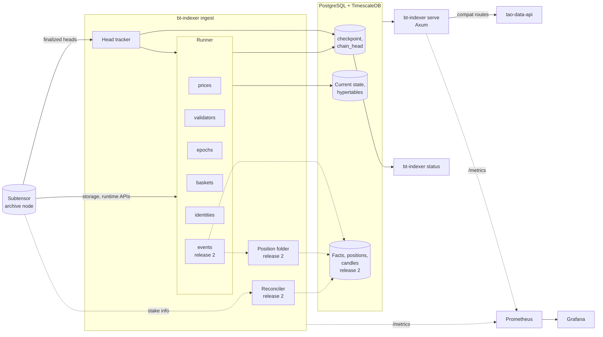

# Overview

The indexer reads the Bittensor chain (subtensor) and stores chain state in PostgreSQL. Release 1 replaces the reference squid for its one consumer, tao-data-api. It serves the five routes that tao-data-api calls, with the same response shapes and the same values. Release 2 adds the event pipeline, positions, and the native analytics. Grafana dashboards and `bt-indexer status` show the progress and health of every job.

## Goals

- **Compatible with tao-data-api.** tao-data-api can point `INDEXER_DATA_API_1` or `INDEXER_DATA_API_2` at the indexer and get its five calls answered with the same paths, shapes, and values as the squid gives. [API](05-api.md#compatibility-routes) gives the contract field by field. Nothing else about the squid is a contract.
- **Correct numbers.** Every value we serve matches what the chain says at the same block. Where the squid's meaning of a value differs from the chain's, we copy the squid's meaning and name it, as with `global_weighted_stake`.
- **Progress you can see.** An operator can see in one command which block every backfill is on, and which block live mode is on. The same numbers appear in `GET /status`, in the metrics, on the dashboard, and in the logs.
- **Restart at any point without damage.** A crash, a deploy, or a lost node connection leaves the database in a state the next run continues from. Every job commits its rows and its checkpoint in one transaction.
- **Every runtime version a job reads.** A job decodes a block's storage and events with the metadata of the runtime that executed the block, and a runtime API result with the metadata of the block's own state ([D6](../decisions.md#d6-decode-storage-and-events-with-the-executing-spec-and-runtime-apis-with-the-blocks-own-spec)). In release 1 the longest window is 31 days. At the head measured on 2026-11-12 it starts at block 9,260,462, so release 1 reads specs 475 to 490 only ([D3](../decisions.md#d3-set-the-milestone-scope-by-what-release-1-reads)). In release 2 the `prices` and `events` jobs reach back to block 4,920,350.

## Non-goals

- **GraphQL.** The squid serves a GraphQL API. We do not implement it, in either release. tao-data-api, the consumer we replace the squid for, calls only REST routes.
- **The rest of the squid's REST API.** Only the five routes that tao-data-api calls are a contract. The squid's other routes, and the `/v1/` twins of four compat routes, are not served.
- **Copying the squid's code.** The squid is a data reference. We take its meaning of each value. We copy its cadences or workarounds only where a value that tao-data-api receives depends on them.
- **A block explorer.** We store no extrinsics, no balances, and no accounts.
- **Blocks before dTAO.** Nothing starts before block 4,920,350, where dTAO started. That block is the upgrade block to spec 233. Its state holds spec 233, but spec 219 executed it, so its events need 219's metadata (`spikes/crates/chain-specs`, `P2`).
- **Writing to the chain.** The indexer reads only. It holds no keys.
- **Unfinalized blocks.** We index finalized blocks only. Decision [D4](../decisions.md#d4-index-finalized-blocks-only) explains why.

## Scope of release 1

Release 1 serves exactly the five compat routes at the host root, plus the operational endpoints. It decodes no events. Five jobs read chain state and write it.

| Job | Schedule | History it keeps | Writes | Feeds |
|---|---|---|---|---|
| `prices` | every block | 2 days | `subnet_price` | `GET /pools` |
| `validators` | blocks where `n % 100 == 0` | latest only | `validator`, `validator_subnet` | `GET /validators` and both stake routes |
| `epochs` | every block | 31 days | `epoch_dividend` | the APYs in both stake routes |
| `baskets` | blocks where `n % 500 == 0`, from spec 441 | 31 days | `basket_snapshot` | the root APR in both stake routes |
| `identities` | blocks where `n % 100 == 0` | latest only | `subnet_identity` | `GET /v1/subnet-identities` |

[Ingestion](03-ingestion.md#run-every-job-on-one-runner) lists what each job reads, and [storage](04-storage.md) gives each table. Release 1 leaves out everything no compat route reads. That covers transfers, staking actions, positions, holder counts, candles, and validator history.

## Scope of release 2

Release 2 adds the event pipeline and the data built on it.

- An `events` job on the same runner. It decodes the events of each block with the metadata of the parent block.
- The position folder and the reconciler, which build current positions from staking events and correct them from chain state.
- Staking actions, transfers, basket flows, subnet snapshots, holder counts, and OHLCV candles.
- The native API under `/api/v1`, described in [API](05-api.md).
- `prices` keeps full history from spec 233, so candles cover all of dTAO.

The [roadmap](10-roadmap.md) orders the work.

## Tech stack

| Concern | Choice | Notes |
|---|---|---|
| Language | Rust, stable, edition 2024 | `rust-toolchain.toml` pins the version |
| Async runtime | `tokio` | Multi-threaded runtime |
| Chain client | `subxt` 0.50 | Makes the RPC calls, and in release 2 decodes events through a `Config` hook that answers the executing spec. See [chain data](02-chain-data.md#give-subxt-the-spec-and-metadata) |
| SCALE decoding | `frame-decode` and `scale-decode` with `#[derive(DecodeAsType)]` | `frame-decode` decodes raw storage bytes and runtime API results against a `subxt::Metadata` we pick, because one subxt hook cannot serve both metadata rules. `DecodeAsType` decodes values and event fields into our own structs |
| Fixed-point numbers | `fixed` | `U64F64`, `I96F32`, and `I64F64` from their raw bits |
| Database | PostgreSQL 17 with the TimescaleDB extension | One database. See [storage](04-storage.md) |
| Database access | `sqlx` with compile-time checked queries and the `bigdecimal` feature | `.sqlx/` offline data is committed, so CI builds without a database. `bigdecimal` maps the `NUMERIC(39,0)` columns |
| HTTP server | `axum` 0.8 on `tower` and `tower-http` | See [API](05-api.md) |
| OpenAPI | `utoipa`, `utoipa-axum`, and `utoipa-swagger-ui` | The specification is generated from the handler types |
| Errors | `thiserror` in library crates, `anyhow` in the binary only | See [error handling](06-error-handling.md) |
| Traces and logs | `tracing`, `tracing-subscriber`, and optionally `tracing-opentelemetry` | JSON logs in production, readable logs in development |
| Metrics | `metrics` and `metrics-exporter-prometheus` | Prometheus scrapes `/metrics` |
| Dashboards | Grafana | Dashboards are JSON files in `deploy/grafana/` |
| Command line | `clap` with derive | One binary with subcommands |
| Configuration | `figment` | Defaults, then a TOML file, then environment variables |
| Shutdown | `tokio-util` `CancellationToken` and `tokio::task::JoinSet` | One token stops every task |
| Tests | `cargo-nextest`, `proptest`, `insta`, `testcontainers`, `criterion`, and a small Node script | The Node script runs tao-data-api's Zod schemas against our responses. See [quality](09-quality.md) |

Release 1 has no rate limiter and no response cache, because its one client has both. [API](05-api.md#shed-load-instead-of-queueing) explains what the API does instead ([D25](../decisions.md#d25-shed-load-on-the-compat-routes-and-do-not-rate-limit-or-cache-in-process)).

`Cargo.toml` pins exact versions. `axum`, `tower-http`, and `utoipa-axum` release in step, so upgrade them together.

### Why we do not depend on subtensor crates

The subtensor repository has the real types, but its crates are a poor dependency for an indexer.

- Even `subtensor-runtime-common` depends on `frame-support`, `sp-runtime`, and `sp-io`.
- Every crate pins a fork of the Polkadot SDK (`RaoFoundation/polkadot-sdk` at a fixed revision) with `[patch]` overrides. The node's lock file has about 1,650 packages.
- The crates describe one runtime version, the current one. They cannot decode a block from spec 233.

We copy the few types we need instead. [Chain data](02-chain-data.md) lists them. The subtensor code is Apache-2.0. Each copied file keeps the license notice and names the source path.

We also rejected `bittensor-rs` from crates.io. It generates bindings from the latest metadata only, so it cannot decode old blocks either. `sdk/bittensor-core` in the subtensor repository decodes dynamically into JSON-like values shaped for the Python SDK. It is not published, and its default features pull in OpenSSL and timelock cryptography.

## Workspace layout

```
crates/
    domain/       Newtypes, domain types, the types several crates name, and pure math: prices, APY, root APR, progress. No I/O, no async.
    chain/        subxt client, metadata cache, and decoders from SCALE to domain types.
    ingest/       The runner, the head tracker, and one module per job. Release 2 adds the position folder and the reconciler.
    store/        sqlx repositories, batch writers, migrations, and every query the API runs.
    api/          Axum router. compat/ holds the frozen routes, ops/ the operational endpoints, and v1/ the release 2 native API.
    telemetry/    Tracing subscriber and metrics exporter setup.
bin/
    indexer/      The bt-indexer binary.
tests/
    compat/       The Node script and the pinned copy of tao-data-api's Zod schemas.
deploy/
    compose.yaml  PostgreSQL with TimescaleDB, Prometheus, Grafana, and the indexer.
    grafana/      Provisioned data sources and dashboards.
    prometheus/   Scrape configuration and alert rules.
fixtures/
    state/        Recorded storage values and runtime API results, one <case>.json per test case.
    metadata/     <spec>.scale, one file per spec that a test uses.
    blocks/       Release 2. Recorded blocks with their events.
docs/
```

Each directory is one package named `bt-<name>`: `bt-domain`, `bt-chain`, `bt-ingest`, `bt-store`, `bt-api`, `bt-telemetry`, and `bt-indexer` for `bin/indexer`. Every command names the package, as in `cargo nextest run -p bt-chain` ([D32](../decisions.md#d32-name-the-crates-bt-name)).

The fixture layout is the one in [quality](09-quality.md#test-the-decoders-against-recorded-blocks). Each state fixture is named for its test case, as in `fixtures/state/prices_head.json`, and holds its block number inside. Metadata files are committed only for the specs a test uses, and a validator snapshot is committed as a trimmed subset ([D34](../decisions.md#d34-keep-one-fixture-per-test-case-and-record-it-by-running-the-jobs-own-read)). Release 1 tests exercise the fixtures of specs 475 to 490. The older era fixtures exist for release 2.

The analytics queries live in `store`, so the compile-time checks of `sqlx` cover them. The analytics math lives in `domain`, so a test can call it without a database.

The dependency direction is fixed. `domain` depends on nothing in the workspace. `chain` and `store` depend on `domain`. `ingest` depends on `chain` and `store`. `api` depends on `store` and `domain`, never on `chain`, so the API keeps working when the node is down. `chain` may not depend on `store`, so when it finds a new spec it returns a `#[must_use] NewRuntime`, and `ingest` stores it in the `runtime_version` table ([D8](../decisions.md#d8-find-the-spec-table-by-bisection-over-code-and-persist-only-the-specs-a-job-window-touches)).

A type that two crates name lives in `domain`, so the direction above holds. These are `Head`, `NewRuntime`, `Timestamp`, `BlockState`, and each job's rows struct ([D33](../decisions.md#d33-put-the-types-that-several-crates-name-in-bt-domain)).

### Subcommands

| Subcommand | What it does |
|---|---|
| `bt-indexer ingest` | Runs the head tracker and every job on the runner |
| `bt-indexer serve` | Runs the API |
| `bt-indexer migrate` | Applies the database migrations |
| `bt-indexer status` | Prints one line per job from the `checkpoint` and `chain_head` tables. Works while the API is down. `--watch` refreshes every 2 seconds |
| `bt-indexer chain specs` | Finds each spec's upgrade block by bisection and writes `fixtures/specs.csv` ([D8](../decisions.md#d8-find-the-spec-table-by-bisection-over-code-and-persist-only-the-specs-a-job-window-touches)) |
| `bt-indexer metadata diff` | Compares the metadata of every spec and lists the storage items, runtime APIs, and events whose shape changed |
| `bt-indexer fixture record` | Runs one job's read at one block against a node through a recording source, and writes the requests and answers into `fixtures/` for offline tests ([D34](../decisions.md#d34-keep-one-fixture-per-test-case-and-record-it-by-running-the-jobs-own-read)) |
| `bt-indexer compat diff --squid <url>` | Fetches the five compat routes from the squid and from the indexer at the same time and prints every field that differs |

You can run `ingest` and `serve` as one process for a demo, or as two processes in production so each restarts on its own.

## Architecture



Dotted lines are release 2.

The workers write to the database. One worker inserts the rows of each table, and no two workers write the same column.

- **The head tracker** polls `chain_getFinalizedHead` every 3 seconds and writes the head to `chain_head` ([D19](../decisions.md#d19-track-the-head-by-polling)). Every job plans its blocks from it.
- **The runner** runs every job the same way. It selects the blocks the job's schedule wants, reads them with bounded concurrency, and commits the rows and the job's checkpoint in one transaction. Each job has its own checkpoint, its own mode (`backfill` or `live`), and its own history window. A slow basket read therefore never delays price points. Release 1 runs `prices`, `validators`, `epochs`, `baskets`, and `identities`. Release 2 adds `events`, which writes staking actions, transfers, and basket flows as facts, and `subnets`, which writes subnet snapshots.
- **The position folder** (release 2) applies staking actions and settles in block order to build current positions. It is the only writer of the position tables.
- **The reconciler** (release 2) reads the true stake of chosen coldkeys from the chain and writes it as settles. [Ingestion](03-ingestion.md#correct-positions-from-chain-state) explains why positions built only from events drift.

[Ingestion](03-ingestion.md#run-every-job-on-one-runner) describes the runner, its backpressure, and its shutdown.

The `serve` subcommand reads from the database only. tao-data-api calls the compat routes, and operators read `GET /status`.

### See progress

`bt-indexer status` answers "which block is each backfill on, and which block is live on" in one command. It prints each job's mode, block, the head, the lag, the percent done, the rate, and the ETA. [Ingestion](03-ingestion.md#see-where-every-job-is) shows its output and the other places the same numbers appear.

## Runtime requirements

- **An archive node.** The jobs read storage and call runtime APIs at old blocks, 31 days back in release 1 and back to block 4,920,350 in release 2. A pruned node keeps only recent state, so a backfill fails on it. Name the node with `BT_CHAIN__URLS`.
- **A node fast enough for the backfill.** The release 1 backfill is about 757,672 calls at the measured head, and the indexer caps itself at 120 calls a second ([D23](../decisions.md#d23-cap-the-call-rate-with-a-one-token-bucket-not-only-the-calls-in-flight)). On 2026-11-12 the keyed archive node, a hosted endpoint that takes an API key, allowed 200 calls a second per key. The public archive node ran at about 9 calls a second at 4 in flight, with no rate-limit error (`spikes/crates/chain-errors`, `P32`). Run your own node or use a keyed endpoint for the backfills, and your own node for release 2.
- **PostgreSQL 17 with TimescaleDB 2.x.** The `deploy/compose.yaml` file starts both.
- **Disk.** [Storage](04-storage.md) estimates the size.
