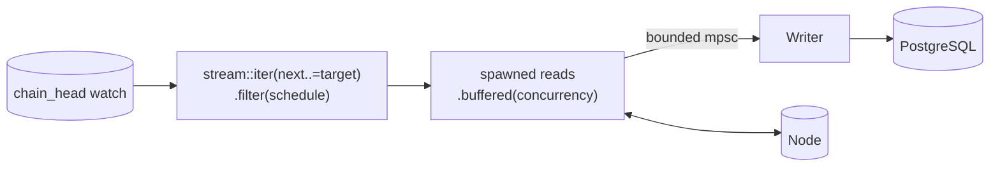
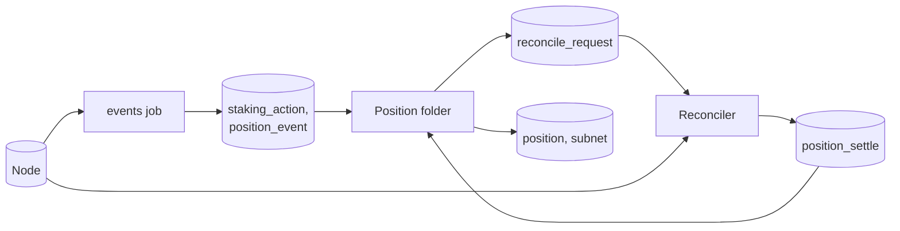

# Ingestion

This document describes how data moves from the node into the database. Every job, in both releases, runs on one runner. The document covers that runner, how an operator sees where each job is, how a slow stage pushes back, how a restart continues where the last run stopped, and how release 2 keeps positions correct.

## Run every job on one runner

A job turns a block into rows. The price reader, the validator snapshot, and release 2's event decoder all have that shape, so one runner drives every job.

| Job (`worker` label) | Release | Schedule | History | Writes |
|---|---|---|---|---|
| `prices` | 1 | every block | `Window(2 days)`. `Full` in release 2 | `subnet_price` |
| `validators` | 1 | every 100 blocks | `Latest` | `validator`, `validator_subnet` |
| `epochs` | 1 | every block | `Window(31 days)` | `epoch_dividend` |
| `baskets` | 1 | every 500 blocks, from spec 441 | `Window(31 days)` | `basket_snapshot` |
| `identities` | 1 | every 100 blocks | `Latest` | `subnet_identity` |
| `events` | 2 | every block | `Full` | `block`, `staking_action`, `transfer`, `basket_flow`, `position_event` |
| `subnets` | 2 | every 100 blocks | `Full` | `subnet_snapshot` |

[Chain data](02-chain-data.md#read-this-chain-state-in-release-1) lists what each release 1 job reads, and [subnet snapshots](02-chain-data.md#read-subnet-snapshots-in-release-2) what `subnets` reads. Release 2 adds two workers that are not jobs, the position folder and the reconciler. [Correct positions from chain state](#correct-positions-from-chain-state) describes them.

```rust
pub trait Job: Send + Sync + 'static {
	const NAME: &'static str;
	type Rows: Send + 'static;
	fn schedule(&self) -> Schedule;
	fn history(&self) -> History;
	fn read(&self, chain: &Chain, at: BlockRef) -> impl Future<Output = Result<Self::Rows, ChainError>> + Send;
	fn write(&self, tx: &mut PgTransaction<'_>, rows: Self::Rows) -> impl Future<Output = Result<(), StoreError>> + Send;
}

pub enum Schedule {
	EveryBlock,
	Every(u32),
}

pub enum History {
	Full,
	Window(Duration),
	Latest,
}
```

`read` talks only to the node, and `write` talks only to the database, so no transaction stays open across a node call. The runner is generic over `J: Job`, and `main` spawns one runner per concrete job.

### Read in order, write in one place

The runner for a job has two stages, the reads and one writer.



1. **Plan.** The runner builds `stream::iter(next..=target).filter(|b| schedule.selects(b))`, where `next` is the checkpoint plus one and `target` is the finalized head. No planner task and no planner channel exist. When the stream ends, the runner waits on the head `watch` channel and builds the next range.
2. **Read.** Each selected block becomes its own task, `.map(|b| tokio::spawn(job.read(b))).buffered(concurrency)`. `buffered` returns results in block order. The task matters. Without it, a `buffered` stream that the runner stops polling keeps its unfinished futures, and each one keeps its RPC permit. With it, each read runs to the end and releases its permits, even while the writer is full.
3. **Write.** One bounded `tokio::sync::mpsc` channel carries the rows to the writer task. The writer groups blocks into a batch and commits it.

If profiling shows that decoding limits the `events` job, it runs the decode on `spawn_blocking` inside the same ordered stream. It never adds a second pipeline.

### Write each batch in one transaction

The writer flushes when the batch holds `batch_blocks` blocks or when `batch_max_wait` passes, whichever comes first. It runs this sequence for each batch.

1. Begin a transaction.
2. Insert each table's rows with one `INSERT ... SELECT * FROM UNNEST(...)` statement per table. Each insert ends with `ON CONFLICT DO NOTHING` on the natural key. A `Latest` job instead deletes the old set and inserts the new one.
3. Update the job's `checkpoint` row to the last block of the batch, with `WHERE last_block < $new`.
4. Commit.

If the process dies before the commit, the database keeps neither the rows nor the new checkpoint. The next run reads the same blocks again and writes the same rows. If the process dies after the commit, the next run starts after the batch. Either way, the database ends in the same state.

`UNNEST` sends a batch as one array per column, so one round trip writes the whole batch. One function per table, such as `fn columns(rows: &[StakingActionRow]) -> StakingActionCols`, builds all of that table's arrays. `query!` cannot check which array goes to which column when two columns share a type, such as `coldkey` and `hotkey`. A round-trip test per batch table, with a distinct value in every column, catches a swap. [Storage](04-storage.md#write-batches-with-unnest) gives the rule.

### Start each job from its history window

`History` decides where a job starts the first time it runs. The job stores that block as `start_block` in its `checkpoint` row, so a restart never moves it.

- `Window(d)` starts at `head − d × 7,200 − 7,200` blocks. The extra 7,200 blocks are a margin of one day. The API filters by timestamp, so the margin covers drift in the block time.
- `Latest` runs only at the newest scheduled block at or below the finalized head. It never backfills. A `Latest` job that restarts after a long stop skips straight to the newest scheduled block.
- `Full` starts at block 4,920,350, the first dTAO block.

A job whose schedule starts at a spec, such as `baskets` at spec 441, starts at the later of its window start and the first block of that spec.

Windowed tables also have a retention policy, so rows older than the window plus 2 days are dropped. [Storage](04-storage.md#drop-old-chunks-with-retention-policies) gives the policies.

### Switch each job between backfill and live settings

Each job has its own mode. A job is in `backfill` until its lag is at most `ingest.live_threshold` blocks (default 20). It then switches to `live`, and logs the switch once. A job that falls more than `live_threshold` blocks behind switches back to `backfill`.

| Setting | Backfill | Live |
|---|---|---|
| `concurrency`, in blocks read at once | 32 | 4 |
| `batch_blocks` | 500 | 1 |
| `batch_max_wait` | 5 s | 0 |

Change these only after the dashboard shows which stage limits throughput. [Observability](07-observability.md#find-the-slow-stage) gives the rule.

### Bound every call with a timeout and a permit

- **Timeout.** Every node call runs inside `tokio::time::timeout(chain.rpc_timeout, call)`, default 30 s. A timeout becomes `ChainError::Timeout`, which retries. Without it, a hung call holds its permit forever and never reaches the latency histogram.
- **Global permits.** A `tokio::sync::Semaphore` with `chain.rpc_max_in_flight` permits (default 64) covers every node call from every job. A call takes a permit for the duration of the call only.
- **Per-job concurrency.** `concurrency` limits the blocks a job reads at once. One block can make several calls, so a job's in-flight calls can exceed its `concurrency`.
- **Database.** The ingest pool has `ingest.db_max_connections` connections (default 10) and `ingest.acquire_timeout` (default 5 s). Each connection sets `statement_timeout` to `ingest.statement_timeout` (default 60 s) in `after_connect`.

`bt_rpc_in_flight{worker}` and `bt_rpc_permit_wait_seconds{worker}` show which job holds the permits and which waits for them.

### Stop cleanly and fail loudly

`SIGTERM` and `SIGINT` cancel one `CancellationToken`. Every `.await` on a channel, the head `watch`, or a node call goes through `select!` on `token.cancelled()`, or through `token.run_until_cancelled(fut)`. A stage that waits therefore wakes up at once on cancel. Checking the token only between items does not wake a stage blocked in `recv()`.

```rust
loop {
	tokio::select! {
		biased;
		_ = token.cancelled() => return writer.commit_and_exit().await,
		msg = rx.recv() => match msg {
			Some(Msg::Rows(block, rows)) => writer.push(block, rows).await?,
			Some(Msg::Done) => return writer.commit_and_exit().await,
			None => return Err(RunnerError::ReadsClosedWithoutDone),
		},
	}
}
```

On cancel, the writer commits the blocks it holds, then exits. The process waits up to `shutdown_timeout` (default 30 s), then aborts what is left. An aborted transaction rolls back, which is safe for the reasons in [one transaction per batch](#write-each-batch-in-one-transaction).

Each job's tasks live in one `JoinSet`. The first task that returns `Err` or panics cancels the token, and the process exits with code 1. A closed channel never counts as success. The read side sends `Msg::Done` before it drops its sender, so a writer that sees the channel close without `Done` reports a failure. A backfill therefore never exits 0 with part of its range missing.

Every release 1 job feeds a compat route, so a job that stops serves wrong data. Release 1 therefore stops the process on any job failure. [Error handling](06-error-handling.md#classify-errors-in-one-place) gives the classes.

### Do not split a backfill

Each job has one runner, and nothing runs block ranges in parallel. More throughput comes from a higher `concurrency`. In a measured probe against a fake node with 100 ms calls, one pipeline at a concurrency of 64 gave 144 blocks per second, the same as two parts at 32 each.

Because one ordered writer commits each job, every `checkpoint.last_block` is a contiguous frontier. Every block at or below it that the schedule selects is written. No range table and no frontier computation exist.

### Follow the finalized head

A head tracker task subscribes to finalized heads with `subxt`. It publishes the latest finalized block number on a `tokio::sync::watch` channel, and writes it with its timestamp to the one-row `chain_head` table. Every runner reads the `watch` channel, and none reads past it.

GRANDPA can finalize several blocks at once, so the subscription can jump from block 100 to block 104. The runners work from block ranges, not from subscription items, so a jump never leaves a gap.

The indexer reads finalized blocks only. A finalized block cannot be reverted, so the indexer needs no rollback code. The cost is about two blocks of extra lag, roughly 24 seconds. The [decisions log](../decisions.md#d3-index-finalized-blocks-only) records the trade.

## See where every job is

Every job writes its progress in the same transaction as its rows. "Which block is each backfill on, and which block is live on?" has four answers, and all four read the same rows.

### The tables

`checkpoint` has one row per worker. `chain_head` has one row, written by the head tracker. [Storage](04-storage.md#pipeline-state) gives the DDL.

| Column | Meaning |
|---|---|
| `checkpoint.worker` | `prices`, `validators`, `epochs`, `baskets`, `identities`, and in release 2 `events` and `positions` |
| `checkpoint.mode` | `backfill` or `live` |
| `checkpoint.start_block` | Where this job's history starts, fixed on its first run |
| `checkpoint.last_block` | The last block committed |
| `checkpoint.last_block_ts` | The chain time of `last_block` |
| `checkpoint.target_block` | The finalized head when the batch was planned |
| `checkpoint.blocks_per_sec` | Blocks of chain covered per second, an EWMA over the last minute |
| `checkpoint.updated_at` | When the last commit happened |
| `chain_head.finalized_block`, `finalized_ts` | The newest finalized block and its time |

A job's **lag** is the distance from its `last_block` to the newest block its schedule selects at or below the finalized head. For an every-block job that block is the head. For `validators`, which runs at multiples of 100, a job that has committed block 9,612,300 has a lag of 0 until the head reaches 9,612,400. Without this rule a healthy 100-block job would always look up to 99 blocks behind. The lag in `status`, `GET /status`, `bt_lag_blocks`, the log line, and the mode switch all use this definition.

**Percent done** is `(last_block − start_block) / (head − start_block) × 100`. **ETA** is `lag / blocks_per_sec` in backfill mode, and empty in live mode. One function in `domain` computes lag, percent done, and ETA from a checkpoint row and the head row. Every place below calls it, so they cannot disagree.

### The command line

`bt-indexer status` reads the two tables directly, so it works when the API is down. It prints one line per job. Add `--watch` to refresh every 2 seconds.

```
WORKER      MODE      BLOCK       HEAD        LAG         DONE    RATE     ETA      COMMITTED
prices      live      9,612,343   9,612,345   2           100%    0.1/s    -        4s ago
validators  live      9,612,300   9,612,345   0           100%    0.1/s    -        9m ago
epochs      backfill  9,488,120   9,612,345   124,225     46.1%   310/s    6m41s    1s ago
baskets     backfill  9,560,000   9,612,345   52,000      77.3%   285/s    3m02s    3s ago
identities  live      9,612,300   9,612,345   0           100%    0.1/s    -        9m ago
```

In this example, `epochs` started at block 9,381,945, which is 32 days of blocks before the head. `baskets` started at 9,382,000, the first multiple of 500 after that. Its newest scheduled block is 9,612,000, so its lag is 52,000.

### The API

`GET /status` returns the same data as JSON, with the readiness result. It is not a compat route. [API](05-api.md#get-status) gives the shape.

### Metrics, the dashboard, and logs

The runner exports these gauges and counters per job. [Observability](07-observability.md) defines the alerts on them.

| Metric | Type | Value |
|---|---|---|
| `bt_chain_finalized_block` | gauge | `chain_head.finalized_block` |
| `bt_checkpoint_block{worker}` | gauge | `last_block` |
| `bt_start_block{worker}` | gauge | `start_block` |
| `bt_lag_blocks{worker}` | gauge | The lag defined above |
| `bt_worker_mode{worker,mode}` | gauge | 1 for the current mode, 0 for the other |
| `bt_last_commit_timestamp_seconds{worker}` | gauge | Unix time of the last commit |
| `bt_blocks_processed_total{worker}` | counter | Blocks committed |

The Grafana indexer dashboard opens with a "Progress" row. The row has one stat panel per job, showing its block, mode, lag, percent done, and ETA.

Every commit logs one `info` line.

```
worker=epochs mode=backfill from=9487810 to=9488120 head=9612345 lag=124225 rate=310/s eta=6m41s
```

The switch between modes logs once, at `info`, with the worker, the old and new mode, and the block.

## Slow stages push back

Every hop between a producer and a consumer has a limit. When a consumer is slow, its producer waits, and the wait travels back to the node. Memory stays bounded, and the node receives no more requests than the database can absorb. An unbounded queue would hide the slow stage. It grows until the process runs out of memory, and every metric looks normal until then.

| Hop | Mechanism | Limit | When the next stage is slow |
|---|---|---|---|
| Head tracker to runners | `tokio::sync::watch` | 1 value | A newer head replaces the old one. Nothing queues |
| Range to reads | `stream::iter(next..=target).filter(schedule)` | Lazy, no channel | The runner pulls the next block number only when `buffered` has room |
| Reads in flight | spawned tasks in `buffered(concurrency)` | `concurrency` blocks, 32 in backfill and 4 in live | The runner stops starting reads. Finished tasks keep their rows, at most `concurrency` blocks |
| Read to node | global `Semaphore` | `chain.rpc_max_in_flight` permits, default 64 | A call waits for a permit. Spawned reads release their permits even while the writer is full |
| Each node call | `tokio::time::timeout` | `chain.rpc_timeout`, default 30 s | The call fails with `ChainError::Timeout` and retries with backoff |
| Reads to writer | bounded `mpsc` | `ingest.channel_capacity` blocks, default 256 | The runner waits in `send`, so it stops polling `buffered` |
| Writer batch | count or time flush | `batch_blocks` or `batch_max_wait` | One transaction per batch |
| Writer to database | ingest `PgPool` | `ingest.db_max_connections` 10, `ingest.acquire_timeout` 5 s | The writer waits for a connection, then fails with a retryable error |
| Each statement | `statement_timeout` | `ingest.statement_timeout`, default 60 s | The statement fails, the transaction rolls back, and the batch retries |
| Folder to `events` (release 2) | the `events` checkpoint | The folder never passes it | The folder waits on the checkpoint |
| Folder to reconciler (release 2) | open `reconcile_request` rows | The folder never passes an open request | The folder waits. `IndexerStalled` pages if it waits too long |
| Reconciler to node (release 2) | global `Semaphore` and `reconcile.concurrency` | `reconcile.concurrency` calls, default 4 | The same as any read |

One job's slow writer stops only that job's reads. Its spawned reads finish and return their permits, so another job's RPC rate holds. [Quality](09-quality.md) tests that property.

[Observability](07-observability.md#find-the-slow-stage) gives the one backward rule that names the slow stage from `bt_pipeline_stage_busy_seconds`, `bt_pipeline_send_wait_seconds`, `bt_rpc_permit_wait_seconds`, and `bt_rpc_in_flight`.

## Survive restarts, node outages, and gaps

### Restart

Each job reads its `checkpoint` row at start and continues from the block after `last_block`. `start_block` stays where it is. No worker keeps state in memory that the database does not also hold. The metadata cache refills from the `runtime_version` table.

A windowed job that was down longer than its window still continues from its checkpoint. Retention drops the rows it writes outside the window. Only `Latest` jobs skip ahead.

### Retry node requests

A node request that fails with a timeout, a lost connection, or a rate-limit response retries with exponential backoff and full jitter. The first wait is 200 ms, and the wait doubles up to 30 seconds. After `chain.rpc_max_retries` attempts, the request fails, and [error handling](06-error-handling.md#classify-errors-in-one-place) decides what happens next. The client reconnects when the WebSocket closes. Configuration can list several node URLs. The client moves to the next URL after repeated failures on the current one.

### Find gaps

The checkpoint cannot skip a block, because one ordered writer commits each job. A gap therefore means a bug, and a check looks for one every hour.

- For `prices`, the check counts the distinct `block_number` values in `subnet_price` between the job's oldest retained block and its `last_block`, and compares the count with the length of that range.
- For `events` in release 2, it compares the `block` table with the range from 4,920,350 to the `events` checkpoint.

A gap logs an error and sets `bt_gap_blocks{worker}`, and the alert fires. To repair it, set the job's `last_block` to the block before the gap. Writes are idempotent, so the job rewrites the rows it already has without change.

## Estimate the backfill time

These numbers are estimates, not measurements. They assume about 50 ms per call to our own archive node and a node that serves about 300 calls per second in total. Replace them with measured numbers after the first backfill.

The count of calls per block, by job:

| Job | Calls per scheduled block | Basis |
|---|---|---|
| `prices`, spec 391 and later | about 3 | The block hash, one `state_queryStorageAt` for every netuid's items and `Timestamp.Now`, one `current_alpha_price_all` |
| `prices`, specs 290 to 390 | about 2 plus one per subnet | One `current_alpha_price(netuid)` call per subnet |
| `epochs` | about 3 | The block hash and one storage read every block. At about 0.35 subnet epochs per block (about 128 subnets at a tempo of 360), about 3 more calls per subnet epoch for the dividend keys, the dividends, and the stakes |
| `baskets` | about 3 | The block hash, the runtime API call, and one `BasketRate` read. The API call takes about 7 seconds, as the reference squid measured |
| `validators` | about 1,000 per snapshot | Paged keys and values of `TotalHotkeyAlpha` and `StakingHotkeys`. The coldkey count behind this is a guess |
| `events` | about 2 | The block hash, and one `state_queryStorageAt` for `System.Events` and `Timestamp.Now`. The indexer stores no extrinsics, so it does not fetch block bodies |

Specs come from the `runtime_version` table, so they cost a call only at a new spec.

**Release 1.** The head in November 2026 is about block 9,612,000.

- `prices` reads 21,600 blocks, about 65,000 calls.
- `epochs` reads 230,400 blocks, about 700,000 calls.
- `baskets` reads about 461 snapshots, about 1,400 calls. At 32 concurrent 7-second calls it takes under 2 minutes. If the node runs only 4 at once, it takes about 13 minutes.
- `validators` and `identities` read one snapshot each.

The total is about 770,000 calls, which takes about 45 minutes at 300 calls per second.

**Release 2.** About 4.69 million blocks lie between block 4,920,350 and the head. This count assumes 12-second blocks.

- `events` needs about 9.4 million calls.
- `prices` with `Full` history needs about 14 million calls at 3 per block.
- Specs 290 to 390 add one call per subnet per block. The git commits for those specs are 255 days apart, about 1.8 million blocks. At about 100 subnets on average, a guess, that is about 180 million more calls.
- The daily reconcile runs at about 650 boundaries, and each reads every coldkey's stake. That is about 3 million calls, a guess that depends on the coldkey count.

Without the per-subnet price era, release 2 needs about 27 million calls, about 25 hours at 300 calls per second. With it, release 2 needs about 210 million calls, about 8 days. The per-subnet price era dominates the cost. Decide how to price specs 290 to 390 for candles before starting the release 2 backfill.

A public endpoint that allows 20 calls per second would take 15 times longer, which is why the overview requires our own node.

## Correct positions from chain state

This section applies to release 2.

A position is the stake of one (coldkey, hotkey, subnet) triple. The position folder builds it by adding and subtracting alpha from staking actions. The reference squid learned that this drifts.

- A hotkey swap moves the stake of every nominator on the hotkey, but carries no amounts.
- A coldkey swap, a root claim, and the swap pallet's liquidity events from specs 290 to 422 move stake with no stake event.
- Emissions and dividends grow stake on every epoch, with no event per position.
- A subnet's removal clears its stake, and later runtimes do that in a separate cleanup block.
- Some runtime migrations rewrote stake directly.

The reconciler corrects the drift by reading the true value from the chain. [Chain data](02-chain-data.md#watch-for-these-traps-in-the-data) cites each case in subtensor.



### Each table has one writer

| Worker | Writes | Order | Checkpoint |
|---|---|---|---|
| `events` job | `block`, `staking_action`, `transfer`, `basket_flow`, `position_event` | Block order, one runner | `checkpoint` row `events` |
| Position folder | `position`, `subnet`, `subnet_holder_count`, `reconcile_request` inserts, `position_settle.drift` | Strict block order | `checkpoint` row `positions` |
| Reconciler | `position_settle` inserts, `reconcile_request.fulfilled_at` | Any | none. It works from open `reconcile_request` rows |

The folder inserts a request and never updates it. The reconciler only sets `fulfilled_at`, in the same transaction as the settles it writes. The reconciler only inserts a settle, and the folder only sets its `drift` when it applies the settle. No two workers write the same column.

### The folder writes the requests, then waits

The `events` job writes facts only. `position_event` holds every event that changes positions or subnets without an amount. Its kinds are `hotkey_swapped`, `hotkey_swapped_on_subnet`, `coldkey_swapped`, `root_claimed`, `liquidity_changed`, `network_added`, `network_removed`, and `network_cleanup_completed`.

The folder never passes the `events` checkpoint. At each block `n`, it runs these steps.

1. **Collect the coldkeys to reconcile at `n`.**
	- For `hotkey_swapped`, every coldkey with a position on the old or the new hotkey, from `position` as of `n − 1` and from the staking actions at `n`.
	- For `hotkey_swapped_on_subnet`, the same, limited to the event's netuid.
	- For `coldkey_swapped`, both coldkeys.
	- For `root_claimed` and `liquidity_changed`, the event's coldkey.
	- For `network_removed` and `network_cleanup_completed`, every coldkey with a position on that netuid.
	- When `n % reconcile.interval_blocks == 0` (default 7,200, about one day), every key of `StakingHotkeys` at `n`. The folder reads those keys from the node. That set includes coldkeys that hold only emissions, which have no `position` row.
2. **Write the requests.** If the set is not empty, the folder inserts one `reconcile_request` row per coldkey at block `n` in its own transaction, and commits. The insert uses `ON CONFLICT DO NOTHING`, so a restart can repeat it.
3. **Wait.** The folder waits until every request at `n` has `fulfilled_at` set.
4. **Apply block `n` in one transaction.**
	- Apply the staking actions in event order.
	- Apply the subnet facts. `network_added` opens a `subnet` row keyed by `(netuid, registered_block)`. `network_removed` sets `removed_block` on the open row for that netuid.
	- Apply the settles. For each fulfilled coldkey, set every position of that coldkey to its settled alpha. Set to 0 every position of that coldkey that the settle does not list, because the runtime API skips zero positions. Record `drift` on each settle row.
	- Move the `positions` checkpoint to `n`, and commit.

Because the folder writes every request itself before it passes the block, no request can arrive after the folder has passed its block. The folder stays the only writer of `position`.

### The reconciler reads the true stake

The reconciler polls for open requests and groups them by block. For each block, it calls `StakeInfoRuntimeApi.get_stake_info_for_coldkeys` at that block with up to `reconcile.coldkeys_per_call` coldkeys per call. The runtime API has no cap of its own, so measure the call size that keeps each call under `chain.rpc_timeout`. In one transaction, it writes one `position_settle` row per returned position and sets `fulfilled_at` on the requests the call covered. Up to `reconcile.concurrency` calls run at once, under the global permits.

### Subtract with checked_sub

Stake grows between settles with no event, so a full unstake can remove more alpha than the folded value holds. The folder applies each removal with `checked_sub`. On underflow, it stores 0 and adds the missing amount to `position.shortfall`. The `CHECK (alpha >= 0)` constraint therefore always holds. The next settle resets `shortfall` to 0, and its `drift` includes the missing amount.

### Positions between settles

Most positions on non-root subnets earn emissions, so they grow between settles. A served position is therefore the last settled value plus the actions since then. The API shows the block of the last settle with every position.

The folder waits without a time limit. `IndexerStalled` pages when the `positions` checkpoint stops moving, which covers a reconciler that cannot finish.

## Configuration

These settings control ingestion. [Quality](09-quality.md#configuration) describes how configuration loads.

| Key | Default | Meaning |
|---|---|---|
| `chain.urls` | none | Archive node WebSocket URLs, tried in order |
| `chain.rpc_max_in_flight` | 64 | Node calls in flight across all workers |
| `chain.rpc_timeout` | 30s | Time limit for one node call |
| `chain.rpc_max_retries` | 8 | Attempts before a call fails |
| `ingest.db_max_connections` | 10 | Connections in the ingest pool |
| `ingest.acquire_timeout` | 5s | Time to wait for an ingest connection |
| `ingest.statement_timeout` | 60s | `statement_timeout` on each ingest connection |
| `ingest.live_threshold` | 20 | Lag in blocks at or below which a job uses live settings |
| `ingest.backfill.concurrency` | 32 | Blocks a job reads at once in backfill |
| `ingest.backfill.batch_blocks` | 500 | Blocks per transaction in backfill |
| `ingest.backfill.batch_max_wait` | 5s | Longest time a backfill batch waits before it commits |
| `ingest.live.concurrency` | 4 | Blocks a job reads at once in live mode |
| `ingest.live.batch_blocks` | 1 | Blocks per transaction in live mode |
| `ingest.channel_capacity` | 256 | Blocks in the channel from a job's reads to its writer |
| `jobs.prices.history` | `2d` | History window for `prices`. Release 2 sets `full` |
| `reconcile.interval_blocks` | 7200 | Blocks between full reconciles (release 2) |
| `reconcile.coldkeys_per_call` | 64 | Coldkeys per `get_stake_info_for_coldkeys` call, to be measured (release 2) |
| `reconcile.concurrency` | 4 | Reconcile calls in flight (release 2) |
| `shutdown_timeout` | 30s | Time to wait for tasks to finish |
