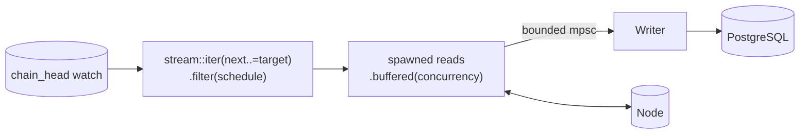
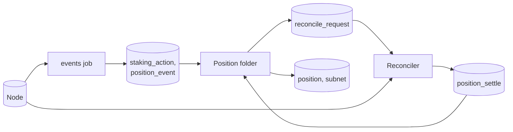

# Ingestion

This document describes how data moves from the node into the database. Every job, in both releases, runs on one runner. The document covers that runner, how an operator sees where each job is, how a slow stage pushes back, how a restart continues where the last run stopped, and how release 2 keeps positions correct.

## Run every job on one runner

A job turns a block into rows. The price reader, the validator snapshot, and release 2's event decoder all have that shape, so one runner drives every job.

| Job (`worker` label) | Release | Schedule | History | Writes |
|---|---|---|---|---|
| `prices` | 1 | every block | `Window(2 days)`. `Full` in release 2 | `subnet_price` |
| `validators` | 1 | every 100 blocks | `Latest` | `validator`, `validator_subnet` |
| `epochs` | 1 | every block | `Window(31 days)` | `epoch_dividend` |
| `baskets` | 1 | every 500 blocks, from spec 441 | `Window(31 days)` | `basket_snapshot` |
| `identities` | 1 | every 100 blocks | `Latest` | `subnet_identity` |
| `events` | 2 | every block | `Full` | `block`, `staking_action`, `transfer`, `basket_flow`, `position_event` |
| `subnets` | 2 | every 100 blocks | `Full` | `subnet_snapshot` |

[Chain data](02-chain-data.md#read-this-chain-state-in-release-1) lists what each release 1 job reads, and [subnet snapshots](02-chain-data.md#read-subnet-snapshots-in-release-2) what `subnets` reads. Release 2 adds two workers that are not jobs, the position folder and the reconciler. [Correct positions from chain state](#correct-positions-from-chain-state) describes them.

The histories in the table take effect in M2. In M1, `prices` starts at the head. `start_block` never moves, so the M1 database is dropped before M2 ([D3](../decisions.md#d3-set-the-milestone-scope-by-what-release-1-reads)).

```rust
pub trait Job: Send + Sync + 'static {
    const NAME: &'static str;
    type Rows: Send + Sync + 'static;
    fn schedule(&self) -> Schedule;
    fn history(&self) -> History;
    fn read<S: BlockSource>(&self, chain: &Chain<S>, at: BlockRef) -> impl Future<Output = Result<Self::Rows, ChainError>> + Send;
    fn block_ts(rows: &Self::Rows) -> Timestamp;
    fn write(&self, tx: &mut PgTransaction<'_>, batch: &[Self::Rows]) -> impl Future<Output = Result<(), StoreError>> + Send;
}

pub enum Schedule {
    EveryBlock,
    Every(NonZeroU32),
}

pub enum History {
    Full,
    Window(Duration),
    Latest,
}
```

`read` talks only to the node, and `write` talks only to the database, so no transaction stays open across a node call. These signatures compile and run in `spikes/crates/runner` ([D18](../decisions.md#d18-give-every-job-one-trait-and-build-the-runner-from-a-spawned-read-stage-and-a-batching-writer)). The reasons for each bound follow.

- `read` is generic over `S: BlockSource`, so the runner tests drive it with a fake source and the product with the real one.
- `write` takes the whole batch, because the writer issues one `UNNEST` per table per batch.
- `block_ts` gives the writer the time of a block, so it can set `checkpoint.last_block_ts` from the batch's last rows.
- `Rows` is `Sync`, because the writer task holds `&[Rows]` across `write().await`. With `Send + 'static` alone, spawning the writer fails to compile.
- `Every` holds a `NonZeroU32`, because the runner computes `head % k`, and `Every(0)` would divide by zero.

The runner is generic over `J: Job` and `S: BlockSource`, and `main` spawns one runner per concrete job. Jobs with different `Rows` types therefore run side by side in one supervisor.

### Read in order, write in one place

The runner for a job has two stages, the reads and one writer.



1. **Plan.** The runner builds `stream::iter(next..=target).filter(|b| schedule.selects(b))`, where `next` is the checkpoint plus one and `target` is the finalized head. When the stream ends, the runner waits on the head `watch` channel and builds the next range.
2. **Read.** Each selected block becomes its own task, and `.buffered(concurrency)` returns the results in block order.
3. **Write.** One bounded `tokio::sync::mpsc` channel carries `ToWriter::Rows(block, rows)` to the writer task, and `ToWriter::End` after the last block of the range. The writer groups blocks into a batch and commits it.

```rust
pub fn spawn_read<J: Job, S: BlockSource>(job: Arc<J>, chain: Arc<Chain<S>>, n: BlockNumber)
    -> AbortOnDropHandle<Result<J::Rows, ChainError>> {
    AbortOnDropHandle::new(tokio::spawn(async move {
        let at = chain.block_ref(n).await?;
        job.read(&chain, at).await
    }))
}
```

The read stage calls `spawn_read` with `Arc` clones of the job and the chain. Three parts of this shape matter, and compile errors and tests in `spikes/crates/runner` check each one.

- **The spawn.** Without it, a `buffered` stream that the runner stops polling keeps its unfinished futures, and they keep RPC permits. In a test of two jobs sharing 8 permits, A held 6 of them that way, and B fell to 50% of the rate it had alone. With the spawn, each read runs to the end and releases its permits even while the writer is full, and B runs at 100%.
- **`Arc` and `async move`.** `tokio::spawn(job.read(chain, at))` does not compile, because the future borrows `&self` and `&chain` and so is not `'static`. Moving the `Arc`s into an `async move` block puts the borrows inside the task's own future.
- **`AbortOnDropHandle`.** A plain `JoinHandle` detaches its task on drop. A read stage that stops on cancel or on an error would leave its reads running and holding permits. `tokio_util::task::AbortOnDropHandle` (tokio-util feature `rt`) aborts the task instead. After a shutdown, no call is in flight and every permit is free.

If profiling shows that decoding limits the `events` job, it runs the decode on `spawn_blocking` inside the same ordered stream. It never adds a second pipeline.

### Write each batch in one transaction

The writer flushes when the batch holds `batch_blocks` blocks or when `batch_max_wait` passes, whichever comes first. It runs this sequence for each batch.

1. Begin a transaction.
2. Call `job.write(&mut tx, &batch)`. It inserts each table's rows with one `INSERT ... SELECT * FROM UNNEST(...)` statement per table. Each insert ends with `ON CONFLICT DO NOTHING` on the natural key. `validators` instead deletes the old set and inserts the new one. `identities` writes only the rows that changed and deletes the subnets that vanished, so `updated_block` keeps its meaning.
3. Update the job's `checkpoint` row to the last block of the batch, with `WHERE last_block < $new`. `last_block_ts` comes from `J::block_ts` on the batch's last rows.
4. Commit.

A batch with no rows never begins a transaction.

If the process dies before the commit, the database keeps neither the rows nor the new checkpoint. The next run reads the same blocks again and writes the same rows. If the process dies after the commit, the next run starts after the batch. Either way, the database ends in the same state.

`UNNEST` sends a batch as one array per column, so one round trip writes the whole batch. One function per table, such as `fn columns(rows: &[StakingActionRow]) -> StakingActionCols`, builds all of that table's arrays. `query!` cannot check which array goes to which column when two columns share a type, such as `coldkey` and `hotkey`. A round-trip test per batch table, with a distinct value in every column, catches a swap. `UNNEST` also accepts arrays of unequal length, and a `NULL` then reaches the column, which a nullable column takes silently (`spikes/crates/store`, `unnest-ragged`). So each column builder asserts that its arrays have equal lengths. [Storage](04-storage.md#write-batches-with-unnest) gives the rule.

### Start each job from its history window

`History` decides where a job starts the first time it runs. The job stores that block as `start_block` in its `checkpoint` row, so a restart never moves it. The first row holds `last_block_ts = to_timestamp(0)`, `target_block = start_block − 1`, and `blocks_per_sec = 0`, and it is inserted with `ON CONFLICT (worker) DO NOTHING`, so a restart leaves `start_block` alone ([D16](../decisions.md#d16-set-the-stores-rules-for-migrations-writes-and-tests)).

- `Window(d)` starts at `head − d × 7,200 − 7,200` blocks. The formula counts a day as 7,200 blocks, 12 s each, and the extra 7,200 blocks are a margin of one day. The measured block time is 12.0 s, or 7,197 blocks a day. The API filters by timestamp, so the margin covers that drift. At the head of 9,490,862, measured on 2026-11-12, `Window(31 days)` starts at 9,260,462 (spec 475), and `prices`' `Window(2 days)` at 9,469,262 (spec 488).
- `Latest` runs only at the newest scheduled block at or below the finalized head. It never backfills. A `Latest` job that restarts after a long stop skips straight to the newest scheduled block.
- `Full` starts at block 4,920,350, the first dTAO block. It is the upgrade block of spec 233: its state reports 233, but spec 219 executed it, so its events decode with 219's metadata. Its storage is still in the old layout, and the dTAO items have no keys until 4,920,351 ([D6](../decisions.md#d6-decode-storage-and-events-with-the-executing-spec-and-runtime-apis-with-the-blocks-own-spec)).

A job whose schedule starts at a spec, such as `baskets` at spec 441, starts at the later of its window start and the first block that spec executes. `Schedule` cannot say "from spec 441", so `start_block` carries the floor. Spec 441's upgrade block is 8,765,683, and the floor is 8,765,684, the block after it. The basket runtime API runs at the upgrade block itself, because the node runs the new code there ([D6](../decisions.md#d6-decode-storage-and-events-with-the-executing-spec-and-runtime-apis-with-the-blocks-own-spec)). But `BasketRate` is storage, read with the executing spec, and at 8,765,683 that is 440, which does not declare it. The floor comes from the `VersionTable`, through `basket_floor(&VersionTable)`. It never binds in release 1. The 31-day window starts later, and the first basket block is 9,260,500 at the measured head.

Windowed tables also have a retention policy, so rows older than the window plus 2 days are dropped. [Storage](04-storage.md#drop-old-chunks-with-retention-policies) gives the policies.

### Switch each job between backfill and live settings

Each job has its own mode. A job is in `backfill` while `last_block < newest_scheduled(schedule, head − ingest.live_threshold)` (default 20 blocks). Once it catches up, it switches to `live` and logs the switch once. A job that falls behind by that test switches back to `backfill`. The test uses the schedule for the same reason readiness does ([D20](../decisions.md#d20-measure-lag-and-readiness-against-the-schedule)). A 100-block job whose lag jumps to 100 at each new scheduled block is not behind. It stays live only if each snapshot commits within 20 blocks, about 240 s. A `validators` snapshot took 131 s at 8 in flight and 451 s at 1.

| Setting | Backfill | Live |
|---|---|---|
| `concurrency`, in blocks read at once | 8 | 4 |
| `batch_blocks` | 500 | 1 |
| `batch_max_wait` | 5 s | 0 |

The backfill `concurrency` is 8 because the measured costs below ran at 8 in flight, and because the rate cap, not the block count, bounds the node load ([D23](../decisions.md#d23-cap-the-call-rate-with-a-one-token-bucket-not-only-the-calls-in-flight)). Change these only after the dashboard shows which stage limits throughput. [Observability](07-observability.md#find-the-slow-stage) gives the rule.

### Bound every call with a timeout, a rate cap, and a permit

- **Timeout.** Every node call runs inside `tokio::time::timeout(chain.rpc_timeout, call)`, default 90 s, because one `get_all_validator_baskets` call takes 8.7 to 33.5 s, depending on node load. The timeout covers the call only. The wait for a permit and a rate token is outside it and has no limit, and `bt_rpc_permit_wait_seconds` shows it. That keeps a cap far below demand from stopping the process. At a cap of 1 with 8 reads, a timeout that also covered the wait timed out 23 of 31 attempts, against 0 of 85 with the timeout around the call only (`spikes/crates/runner-live`, `timeout-scope`, [D23](../decisions.md#d23-cap-the-call-rate-with-a-one-token-bucket-not-only-the-calls-in-flight)). A timeout becomes `ChainError::Timeout`, which retries. Without it, a hung call holds its permit forever and never reaches the latency histogram. The reconnecting client also queues a call made while the socket is down, so during an outage only this timeout ends the call. The client has its own `request_timeout`, 60 s by default, which would fail a call before `rpc_timeout`. `connect` sets it to `chain.rpc_timeout + 30 s`, and `classify` maps the client's timeout to `ChainError::Timeout` too ([D22](../decisions.md#d22-classify-chain-errors-by-what-the-node-sends-and-bound-the-clients-waits-with-our-own-timeouts), `spikes/crates/chain-errors`, `client-request-timeout`).
- **Rate cap.** A token bucket of `chain.rpc_max_per_second` (default 120) covers every node call from every job ([D23](../decisions.md#d23-cap-the-call-rate-with-a-one-token-bucket-not-only-the-calls-in-flight)). A call takes its permit first and its rate token last, so a call that waits for a permit holds no token. With the token first, 20 calls started in one window at a cap of 10, against 10 with the permit first (`spikes/crates/runner-live`, `token-permit-order`). The bucket holds one token, so calls start at least `1 / rpc_max_per_second` apart, and over real time the client counts at most the cap plus one in any second (`spikes/crates/runner-live`, `cap-window`). The bucket counts `BlockSource` calls, not node requests. `finalized_head` is one call and two requests (`spikes/crates/runner-live`, `head-two-requests`). The keyed archive node allows 200 calls a second per key (`x-ratelimit-limit-sec: 200`), and 120 leaves room for other users of the key. Above the limit, a call fails with JSON-RPC error `-32029`. Over HTTP it arrives inside an HTTP 429, and over WebSocket it is an error on that call, with the socket left open. A run at 133 calls a second stayed clean for 60 s. The same gateway with no key accepts the connection and allows 10 calls a second, so a URL that lost its key starts and then answers mostly `-32029` (`spikes/crates/chain-errors`, `gateway-keyless`). Permits alone do not bound the rate, because the rate they allow is the permit count divided by the call latency. At a p50 of 90 to 140 ms, a pool raised to 64 permits would ask for 450 to 700 calls a second, and retries under steady over-demand would use up `chain.rpc_max_retries`.
- **Global permits.** A `tokio::sync::Semaphore` with `chain.rpc_max_in_flight` permits (default 16) covers every node call from every job. A call holds its permit while it waits for its rate token and while it runs, and gives it back when the call ends.
- **Per-job concurrency.** `concurrency` limits the blocks a job reads at once. One block can make several calls, so a job's in-flight calls can exceed its `concurrency`.
- **Database.** The ingest pool has `ingest.db_max_connections` connections (default 10) and `ingest.acquire_timeout` (default 5 s). Each connection sets `statement_timeout` to `ingest.statement_timeout` (default 60 s) in `after_connect`.

`bt_rpc_in_flight{worker}` and `bt_rpc_permit_wait_seconds{worker}` show which job holds the permits and which waits for them. `Chain::call` takes the label from its own `Chain` value. `main` builds one per job with `chain.for_worker(J::NAME)`, and one for the head tracker with `worker="head"`. They share the source, the metadata cache, and the limits behind `Arc` ([D21](../decisions.md#d21-call-the-node-in-two-layers), `spikes/crates/runner-live`, `wiring`). The labels are accurate only because every read is spawned. A permit granted to a waiter that nobody polls is not a call in flight. In the 8-permit test above, job A without the spawn showed 2 calls in flight while it held 6 permits.

### Stop cleanly and fail loudly

`SIGTERM` and `SIGINT` cancel one `CancellationToken`. Every `.await` on a channel, the head `watch`, or a node call goes through `select!` on `token.cancelled()`, or through `token.run_until_cancelled(fut)`. A stage that waits therefore wakes up at once on cancel, even while it is blocked in `recv()`.

The writer waits in one function, `next_event`, and commits outside it.

```rust
async fn next_event<R>(rx: &mut mpsc::Receiver<ToWriter<R>>, deadline: Option<Instant>, token: &CancellationToken) -> Event<R> {
    let at = deadline.unwrap_or_else(Instant::now);
    tokio::select! {
        biased;
        _ = token.cancelled() => Event::Cancelled,
        _ = tokio::time::sleep_until(at), if deadline.is_some() => Event::Deadline,
        msg = rx.recv() => match msg {
            Some(ToWriter::Rows(n, rows)) => Event::Rows(n, rows),
            Some(ToWriter::End) => Event::End,
            None => Event::Closed,
        },
    }
}

loop {
    match next_event(&mut rx, batch.deadline, &token).await {
        Event::Rows(n, rows) => {
            if batch.push(n, rows, &settings) {
                commit(&mut batch).await?;
            }
        }
        Event::Deadline => commit(&mut batch).await?,
        Event::End | Event::Cancelled => return commit(&mut batch).await,
        Event::Closed => {
            commit(&mut batch).await?;
            return Err(RunnerError::UpstreamClosed);
        }
    }
}
```

`commit` takes the batch with `batch.take()` and runs `commit_batch`, which does nothing for an empty batch. Three details of this shape matter, each checked in `spikes/crates/runner` ([D18](../decisions.md#d18-give-every-job-one-trait-and-build-the-runner-from-a-spawned-read-stage-and-a-batching-writer)).

- **The commit runs outside the `select!`.** Inside a branch that can lose to `token.cancelled()`, the commit future is dropped halfway. The writer then returns `Ok` with no checkpoint and no rows written.
- **The order is cancel, then deadline, then `recv`.** With `recv` before the deadline, a busy channel never lets the deadline win, so `batch_max_wait` never flushes a batch.
- **The deadline uses `unwrap_or_else(Instant::now)`.** `select!` evaluates a disabled branch's expression too, so `deadline.unwrap()` behind `if deadline.is_some()` panics. The tokio documentation says so (`tokio-1.54.1/src/macros/select.rs:28-41`, "`<async expression>` is still evaluated but the resulting future is never polled").

On cancel, the writer commits the blocks it holds, then exits. The process waits up to `shutdown_timeout` (default 30 s), then aborts what is left. An aborted transaction rolls back, which is safe for the reasons in [one transaction per batch](#write-each-batch-in-one-transaction). A signal shutdown exits with code 0 even in the two cases below, because writes are idempotent and the next run repeats the blocks.

- A task that `shutdown_timeout` aborts. The supervisor logs a warning that says how many tasks it aborted, so the operator sees it.
- A cancel that arrives while the writer waits in a commit backoff. The writer gives up the batch and exits. `retry_with_backoff(policy, token, op)` selects on the token only in its backoff sleep. An attempt never does, so a commit is never dropped halfway. On cancel, `retry_with_backoff` still returns the last error. In `commit_batch`, a `Retry` error after a cancelled token becomes `Ok(Committed::Stopped)`, so the writer stops cleanly and the process exits 0. Any other error stays an error, so a fatal error during shutdown still exits 1 (`spikes/crates/runner`, `cancel-in-commit-backoff`, [D18](../decisions.md#d18-give-every-job-one-trait-and-build-the-runner-from-a-spawned-read-stage-and-a-batching-writer)).

Each job's tasks live in one `JoinSet`. The first task that returns `Err` or panics cancels the token, and the process exits with code 1. A closed channel never counts as success. The read side sends `ToWriter::End` before it drops its sender, so a writer that sees the channel close without `End` returns `RunnerError::UpstreamClosed`. A backfill therefore never exits 0 with part of its range missing.

Every release 1 job feeds a compat route, so a job that stops serves wrong data. Release 1 therefore stops the process on any job failure. [Error handling](06-error-handling.md#classify-errors-in-one-place) gives the classes.

### Run each backfill as one ordered pipeline

Each job has one runner, which reads its whole range in block order. More throughput comes from a higher `concurrency`. Parallel parts of a range would share the same permits and rate cap, so two parts at half the concurrency put the same calls in flight as one part at the full concurrency.

Because one ordered writer commits each job, every `checkpoint.last_block` is a contiguous frontier. Every block at or below it that the schedule selects is written.

### Follow the finalized head

A head tracker task polls `chain_getFinalizedHead` every 3 s ([D19](../decisions.md#d19-track-the-head-by-polling)). It publishes the latest finalized block number on a `tokio::sync::watch` channel, and writes it with its timestamp to the one-row `chain_head` table. Every runner reads the `watch` channel, and none reads past it.

The tracker polls instead of subscribing. A finalized-head subscription ends on any socket drop. The reconnecting client yields one `DisconnectedWillReconnect` item and then the stream ends, and the plain client's stream just ends. `BlockSource` also has no subscription method. Measured over 120 s on 2026-11-12, polling reached the same last head as a subscription, about 2.1 s later on average and 3.5 s at most, and never went backwards. Each poll is one `finalized_head` call, which makes two node requests.

On each new head, the tracker also reads `state_getStorageHash(":code")`. A changed hash means a new spec. `chain` returns it as a `#[must_use] NewRuntime`, and `ingest` stores it in `runtime_version`, because `chain` may not depend on `store` ([D8](../decisions.md#d8-find-the-spec-table-by-bisection-over-code-and-persist-only-the-specs-a-job-window-touches)). Specs come from the in-memory spec table, seeded from `fixtures/specs.csv`. One `:code` hash call at each range end, and one at each new head, rules out a new spec in between, because two upgrades can come 2 blocks apart. The call takes about 0.3 s.

GRANDPA can finalize several blocks at once, so two polls can jump from block 100 to block 104. The runners work from block ranges, not from single heads, so a jump never leaves a gap.

The indexer reads finalized blocks only. A finalized block cannot be reverted, so the indexer needs no rollback code. The cost is about two blocks of extra lag, roughly 24 seconds. Best head minus finalized head was 2 blocks in 6 of 6 samples 7 s apart on 2026-11-13 (`spikes/crates/chain-errors`, `finality-gap`). The polling adds about 2 s on average. The [decisions log](../decisions.md#d4-index-finalized-blocks-only) records the trade.

## See where every job is

Every job writes its progress in the same transaction as its rows. "Which block is each backfill on, and which block is live on?" has four answers, and all four read the same rows.

### The tables

`checkpoint` has one row per worker. `chain_head` has one row, written by the head tracker. [Storage](04-storage.md#pipeline-state) gives the DDL.

| Column | Meaning |
|---|---|
| `checkpoint.worker` | `prices`, `validators`, `epochs`, `baskets`, `identities`, and in release 2 `events`, `subnets`, and `positions` |
| `checkpoint.mode` | `backfill` or `live` |
| `checkpoint.start_block` | Where this job's history starts, fixed on its first run |
| `checkpoint.last_block` | The last block committed |
| `checkpoint.last_block_ts` | The chain time of `last_block` |
| `checkpoint.target_block` | The finalized head that the writer reads from the head `watch` when it commits. Only the read stage knows the head a batch was planned against, so the writer records the head it sees |
| `checkpoint.blocks_per_sec` | Blocks of chain covered per second, an EWMA over the last minute |
| `checkpoint.updated_at` | When the last commit happened |
| `chain_head.finalized_block`, `finalized_ts` | The newest finalized block and its time |

A job's **lag** is the distance from its `last_block` to the newest block its schedule selects at or below the finalized head. For an every-block job that block is the head. For `validators`, which runs at multiples of 100, a job that has committed block 9,491,300 has a lag of 0 until the head reaches 9,491,400. Without this rule a healthy 100-block job would always look up to 99 blocks behind. The lag in `status`, `GET /status`, `bt_lag_blocks`, and the log line all use this definition. The mode switch and `/readyz` ask a different question, whether the job is behind, and answer it with `last_block < newest_scheduled(schedule, head − threshold)`. Lag alone would call a 100-block job behind from the moment the head reaches its next scheduled block until that snapshot commits.

**Percent done** is `(last_block − start_block) / (newest_scheduled(schedule, head) − start_block) × 100`, and 100 when the divisor is not positive. Against the raw head, a caught-up `validators` or `identities` job would print 0.0%, and a caught-up `baskets` job 99.85%. **ETA** is `lag / blocks_per_sec` in backfill mode, and empty in live mode. One function, `progress(checkpoint, schedule, head)`, computes lag, percent done, and ETA, and prints percent done with one decimal. The checkpoint row does not hold the schedule, so `bt-domain` holds one table from worker name to `Schedule` ([D20](../decisions.md#d20-measure-lag-and-readiness-against-the-schedule)). Every place below calls `progress` with that table, so they agree. The Grafana panel computes the percentage in PromQL and differs in one case, which [observability](07-observability.md#provision-the-dashboards-from-files) states.

### The command line

`bt-indexer status` reads the two tables directly, so it works when the API is down. It prints one line per job. Add `--watch` to refresh every 2 seconds.

```
WORKER      MODE      BLOCK       HEAD        LAG         DONE    RATE     ETA      COMMITTED
prices      live      9,491,343   9,491,345   2           100.0%  0.1/s    -        4s ago
validators  live      9,491,300   9,491,345   0           100.0%  0.1/s    -        9m ago
epochs      backfill  9,450,000   9,491,345   41,345      82.1%   21.9/s   31m28s   1s ago
baskets     backfill  9,440,000   9,491,345   51,000      77.9%   83/s     10m14s   3s ago
identities  live      9,491,300   9,491,345   0           100.0%  0.1/s    -        9m ago
```

In this example, the jobs first ran at the head of 9,490,862, measured on 2026-11-12 (`spikes/crates/chain-specs`, `P29`). `epochs` started at block 9,260,462, its 31-day window plus one day of margin before that head. `baskets` started at 9,260,500, the first multiple of 500 after that. Its newest scheduled block is 9,491,000, so its lag is 51,000, and it is 179,500 of 230,500 blocks done. The `epochs` rate is near the measured 21.95 blocks a second at 8 in flight. The `baskets` rate assumes the mean basket call of 24 s measured at up to 4 in flight. The `prices` row prints 100.0% because 22,081 of 22,083 blocks round up.

### The API

`GET /status` returns the same data as JSON, with the readiness result. It is not a compat route. [API](05-api.md#get-status) gives the shape.

### Metrics, the dashboard, and logs

The runner exports these gauges and counters per job. [Observability](07-observability.md) defines the alerts on them.

| Metric | Type | Value |
|---|---|---|
| `bt_chain_finalized_block` | gauge | `chain_head.finalized_block` |
| `bt_checkpoint_block{worker}` | gauge | `last_block` |
| `bt_start_block{worker}` | gauge | `start_block` |
| `bt_lag_blocks{worker}` | gauge | The lag defined above |
| `bt_worker_mode{worker,mode}` | gauge | 1 for the current mode, 0 for the other |
| `bt_last_commit_timestamp_seconds{worker}` | gauge | Unix time of the last commit |
| `bt_blocks_processed_total{worker}` | counter | Blocks committed |

The Grafana indexer dashboard opens with a "Progress" row. The row has one stat panel per job, showing its block, mode, lag, percent done, and ETA.

Every commit logs one `info` line.

```
worker=epochs mode=backfill from=9449501 to=9450000 head=9491345 lag=41345 rate=21.9/s eta=31m28s
```

The switch between modes logs once, at `info`, with the worker, the old and new mode, and the block.

## Slow stages push back

Every hop between a producer and a consumer has a limit. When a consumer is slow, its producer waits, and the wait travels back to the node. Memory stays bounded, and the node receives no more requests than the database can absorb. An unbounded queue would hide the slow stage. It grows until the process runs out of memory, and every metric looks normal until then.

| Hop | Mechanism | Limit | When the next stage is slow |
|---|---|---|---|
| Head tracker to runners | `tokio::sync::watch` | 1 value | A newer head replaces the old one. Nothing queues |
| Range to reads | `stream::iter(next..=target).filter(schedule)` | Lazy, no channel | The runner pulls the next block number only when `buffered` has room |
| Reads in flight | spawned tasks in `buffered(concurrency)` | `concurrency` blocks, 8 in backfill and 4 in live | The runner stops starting reads. Finished tasks keep their rows, at most `concurrency` blocks |
| Read to node | global `Semaphore` | `chain.rpc_max_in_flight` permits, default 16 | A call waits for a permit. Spawned reads release their permits even while the writer is full |
| Calls per second | token bucket of one token, taken after the permit | `chain.rpc_max_per_second`, default 120 | A call that holds a permit waits for a token |
| Each node call | `tokio::time::timeout`, around the call only | `chain.rpc_timeout`, default 90 s | The call fails with `ChainError::Timeout` and retries with backoff |
| Reads to writer | bounded `mpsc` | `ingest.channel_capacity` blocks, default 256 | The runner waits in `send`, so it stops polling `buffered` |
| Writer batch | count or time flush | `batch_blocks` or `batch_max_wait` | One transaction per batch |
| Writer to database | ingest `PgPool` | `ingest.db_max_connections` 10, `ingest.acquire_timeout` 5 s | The writer waits for a connection, then fails with a retryable error |
| Each statement | `statement_timeout` | `ingest.statement_timeout`, default 60 s | The statement fails, the transaction rolls back, and the batch retries |
| Folder to `events` (release 2) | the `events` checkpoint | The folder never passes it | The folder waits on the checkpoint |
| Folder to reconciler (release 2) | open `reconcile_request` rows | The folder never passes an open request | The folder waits. `IndexerStalled` pages if it waits too long |
| Reconciler to node (release 2) | global `Semaphore` and `reconcile.concurrency` | `reconcile.concurrency` calls, default 4 | The same as any read |

So the rows one job holds in memory peak at `batch_blocks + channel_capacity + concurrency` blocks, which are the writer's batch, the full channel, and the finished reads. With the backfill defaults that is 500 + 256 + 8 = 764 blocks. In a test with the writer stalled and `concurrency` raised to 32, rows alive stayed at 788 = 500 + 256 + 32 from 10 s to 70 s, no call was in flight, and new heads started no reads.

One job's slow writer stops only that job's reads. Its spawned reads finish and return their permits, so another job's RPC rate holds. [Quality](09-quality.md) tests that property.

[Observability](07-observability.md#find-the-slow-stage) gives the one backward rule that names the slow stage from `bt_pipeline_stage_busy_seconds`, `bt_pipeline_send_wait_seconds`, `bt_rpc_permit_wait_seconds`, and `bt_rpc_in_flight`.

## Survive restarts, node outages, and gaps

### Restart

Each job reads its `checkpoint` row at start and continues from the block after `last_block`. `start_block` stays where it is. No worker keeps state in memory that the database does not also hold. The metadata cache refills from the `runtime_version` table.

A windowed job that was down longer than its window still continues from its checkpoint. Retention drops the rows it writes outside the window. Only `Latest` jobs skip ahead.

### Retry node requests

A node request that fails with a timeout, a lost connection, or a rate-limit response retries with exponential backoff and full jitter. The first wait is 200 ms, and the wait doubles up to 30 seconds. After `chain.rpc_max_retries` attempts, the request fails, and [error handling](06-error-handling.md#classify-errors-in-one-place) decides what happens next. A rate-limited call recovers in under 0.4 s. The jitter comes from `rand::rng()`, created inside the `backoff` call and never held across the sleep. `ThreadRng` is not `Send`, and holding it across an await makes every spawned read fail to compile (`spikes/crates/runner-live`, `rng-send`, [D23](../decisions.md#d23-cap-the-call-rate-with-a-one-token-bucket-not-only-the-calls-in-flight)).

The client reconnects when the WebSocket closes. subxt's reconnecting RPC client retries one URL forever, with a backoff from 10 ms that doubles to 60 s, and it does not fail over to another URL ([D22](../decisions.md#d22-classify-chain-errors-by-what-the-node-sends-and-bound-the-clients-waits-with-our-own-timeouts)). The indexer adds no failover code, so it connects to the first URL in `BT_CHAIN__URLS`. During an outage, a call waits until `chain.rpc_timeout` with no error. The signals are `bt_rpc_disconnects_total`, which counts each call that was in flight when the socket dropped, and the timeouts in `bt_rpc_requests_total{outcome="timeout"}`. A reconnect with no call in flight is not counted, because subxt exposes no reconnect counter or callback (`spikes/crates/chain-errors`, `disconnect-counter`).

When the gateway rejects every new handshake, a call on the reconnecting client sees no error. It waits until `chain.rpc_timeout`, and it succeeds once a handshake is accepted again (`spikes/crates/chain-errors`, `reconnecting-handshake-rejected`). So a rejected handshake shows up only as timeouts. The plain client returns an error at once (`spikes/crates/chain-errors`, `ws-handshake-rejected`).

### Find gaps

The checkpoint cannot skip a block, because one ordered writer commits each job. A gap therefore means a bug, and a check looks for one every hour.

- For `prices`, the check counts the distinct `block_number` values in `subnet_price` between the job's oldest retained block and its `last_block`, and compares the count with the length of that range. It counts the rows of a `SELECT DISTINCT block_number` subquery, which hashes and took about 0.12 s. `count(DISTINCT block_number)` spilled an 80 MB sort to disk and took 1.6 to 2.4 s (`spikes/crates/store`, `read-gap`).
- For `events` in release 2, it compares the `block` table with the range from 4,920,350 to the `events` checkpoint.

A gap logs an error and sets `bt_gap_blocks{worker}`, and the alert fires. To repair it, set the job's `last_block` to the block before the gap. Writes are idempotent, so the job rewrites the rows it already has without change.

## Estimate the backfill time

The per-job costs below were measured on the keyed archive node over HTTP, on 2026-11-12 (`spikes/crates/chain-decode`, `out/cost.txt`). The product uses one WebSocket. Over it, `prices` ran 10.99 blocks a second for 2,000 blocks under a cap of 40, near its HTTP rate. For windows of minutes the node slowed to about 2 blocks a second, with no error and whatever the number of reads in flight (`spikes/crates/runner-live`, `backfill-ws`, `node-slow-windows`).

| Job | Calls per read | Bytes | Time | Basis |
|---|---|---|---|---|
| `prices`, spec 490 | 3 per block | 54 KB | 2.07 s at 1 in flight, 11.29 to 12.97 blocks a second at 8 | The block hash, one `state_queryStorageAt` for every netuid's items and `Timestamp.Now`, one `current_alpha_price_all` |
| `prices`, specs 290 to 390 (release 2) | 131 per block | about 100 KB | 266 to 375 s per block at 2 in flight (`spikes/crates/chain-decode`, `per-subnet-price-cost`) | One `current_alpha_price(netuid)` call per subnet, 128 at the measured block, plus the 3 fixed calls |
| `epochs` at 9,490,000 | 3.0 per block | 23 KB | 0.35 s at 1 in flight, 14.96 to 21.95 blocks a second at 8 | The block hash and one storage read every block, plus the dividend keys, the dividends, and the stakes at each subnet epoch. The head ran 0.345 subnet epochs per block. Older blocks cost fewer calls, 2.53 at 9,260,000 and about 2.3 at the dTAO start |
| `baskets` | 3 per snapshot | about 444 KB | one `get_all_validator_baskets` call of 8.7 to 33.5 s, depending on node load | The block hash, the runtime API call, and one `BasketRate` read. Bytes are 1,775,948 over 4 snapshots (`spikes/crates/chain-decode`, `baskets-cost`) |
| `validators` at 9,490,000 | 286 per snapshot (140 key pages, 145 queries) | 57.4 MB | 451 s at 1 in flight, 131 s at 8 | Paged keys and values of `TotalHotkeyAlpha` and `StakingHotkeys` |
| `validators` at 8,636,100 | 480 per snapshot | 118.8 MB | 170.6 s at 8 (`spikes/crates/chain-decode`, `validators-cost-8636100`) | The same |
| `validators` at 4,920,400 | 367 per snapshot | 69.2 MB | 1,160 s at 1 in flight, 301 s at 8 | The same |
| `identities` | 8 | 605 KB | 1.6 s at 1 in flight, 1.2 s at 8 | The measurement also ran an `IdentitiesV2` scan that the job does not make. The job makes 3 calls, one key page, one query, and the block hash |
| `events` (release 2) | about 2 per block, an estimate | | | The block hash, and one `state_queryStorageAt` for `System.Events` and `Timestamp.Now`. The indexer stores no extrinsics, so it does not fetch block bodies |

**Release 1.** The windows start from the head of 9,490,862, measured on 2026-11-12 (`spikes/crates/chain-specs`, `P29`). The `prices` and `epochs` times use their rates at 8 in flight from the table (`spikes/crates/chain-decode`, `rates-range`).

- `prices` reads 21,600 blocks × 3 = 64,800 calls. That takes 28 min at 12.97 blocks a second and 32 min at 11.29.
- `epochs` reads 230,400 blocks × 3.0 = 691,200 calls. This is an upper end, because 3.0 calls per block was measured near the head and 2.53 at 9,260,000 (`spikes/crates/chain-decode`, `backfill-r1`). That takes 2 h 55 min at 21.95 blocks a second and 4 h 17 min at 14.96.
- `baskets` reads 461 snapshots × 3 = 1,383 calls. At the mean call of 24 s, measured at up to 4 in flight, that takes about 46 min.
- `validators` reads one snapshot of 286 calls, which takes 2 to 8 minutes, and `identities` one of 3 calls.

The release 1 backfill is about 757,672 calls and about 6.8 GB. The time is an estimate between two bounds, about 1 h 30 min and 5 h 35 min. The jobs share one rate cap and run at the same time, so the real time lies between them. The low end is the rate cap. At 120 calls a second, 757,672 calls take about 1 h 45 min, and about 1 h 30 min if `epochs` costs 2.53 calls per block across the window. The high end runs `epochs`, `prices`, and `baskets` one after another at their slower rates. The estimate assumes that every job keeps the rate it had alone over HTTP while all five share 16 permits, and that the node has no slow windows. The range does not cover slow windows, or historic `state_call` latency, which varied from 0.3 s to 19 s for one call.

**Release 2.** About 4.57 million blocks lie between block 4,920,350 and the head of 9,490,862. The `events` and reconcile counts are estimates.

- `events` needs about 9.1 million calls at about 2 per block.
- `prices` with `Full` history needs about 14 million calls at 3 per block. That covers every block of the range, 4,570,513 × 3 ≈ 13.7 million, including the blocks of the per-subnet era below.
- Specs 290 to 390 cost one call per subnet per block. The last spec of that era that mainnet ran is 385. The era ran from block 5,947,548 to 7,782,856, which is 255 days and 1,835,309 blocks. At 128 subnets that is (7,782,856 − 5,947,548 + 1) × 128 = 234,919,552 calls, about 23 days at 120 calls a second. That figure counts the 128 price calls only. With the 3 fixed calls, a block costs 131 calls. The 23 days are a floor. The era's first and last blocks took 375 s and 266 s for their 131 calls at 2 in flight, far below that rate, so release 2 measures this era before it backfills it.
- The daily reconcile runs at about 650 boundaries, and each reads every coldkey's stake. That is about 3 million calls, depending on the coldkey count.

Without the per-subnet price era, release 2 needs about 26 million calls, about 2.5 days at 120 calls a second. With it, release 2 needs about 261 million calls, about 25 days at that rate, also a floor. The per-subnet price era dominates the cost. Decide how to price specs 290 to 390 for candles before starting the release 2 backfill.

The public archive node is too slow for a backfill. On 2026-11-12 it ran at about 9 calls a second at 4 in flight with no rate-limit error, and a heavier mix of 47 `state_getKeysPaged` and `state_call` calls drew no limit either ([D23](../decisions.md#d23-cap-the-call-rate-with-a-one-token-bucket-not-only-the-calls-in-flight), `spikes/crates/chain-errors`, `P32`). Latency, not a limit, sets that rate. No call has returned `-32004`, a rate-limit code that no source documents (`spikes/crates/chain-errors`, `node-error-codes`). Release 1's 757,672 calls would take about 23 hours on it, which is why the overview requires our own node or a keyed endpoint.

## Correct positions from chain state

This section applies to release 2.

A position is the stake of one (coldkey, hotkey, subnet) triple. The position folder builds it by adding and subtracting alpha from staking actions. The reference squid learned that this drifts.

- A hotkey swap moves the stake of every nominator on the hotkey, but carries no amounts.
- A coldkey swap, a root claim, and the swap pallet's liquidity events from specs 290 to 422 move stake with no stake event.
- Emissions and dividends grow stake on every epoch, with no event per position.
- A subnet's removal clears its stake, and later runtimes do that in a separate cleanup block.
- Some runtime migrations rewrote stake directly.

The reconciler corrects the drift by reading the true value from the chain. [Chain data](02-chain-data.md#watch-for-these-traps-in-the-data) cites each case in subtensor.



### Each column has one writer

| Worker | Writes | Order | Checkpoint |
|---|---|---|---|
| `events` job | `block`, `staking_action`, `transfer`, `basket_flow`, `position_event` | Block order, one runner | `checkpoint` row `events` |
| `subnets` job | `subnet_snapshot` | Block order, one runner | `checkpoint` row `subnets` |
| Position folder | `position`, `subnet`, `subnet_holder_count`, `reconcile_request` inserts, `position_settle.drift` | Strict block order | `checkpoint` row `positions` |
| Reconciler | `position_settle` inserts, `reconcile_request.fulfilled_at` | Any | none. It works from open `reconcile_request` rows |

Two workers share `reconcile_request` and `position_settle`, and each column has one of them as its writer. The folder inserts each request, and the reconciler sets only its `fulfilled_at`, in the same transaction as the settles it writes. The reconciler inserts each settle, and the folder sets only its `drift` when it applies the settle.

### The folder writes the requests, then waits

The `events` job writes facts only. `position_event` holds every event that changes positions or subnets without an amount. Its kinds are `hotkey_swapped`, `hotkey_swapped_on_subnet`, `coldkey_swapped`, `root_claimed`, `liquidity_changed`, `network_added`, `network_removed`, and `network_cleanup_completed`.

The folder never passes the `events` checkpoint. At each block `n`, it runs these steps.

1. **Collect the coldkeys to reconcile at `n`.**
	- For `hotkey_swapped`, every coldkey with a position on the old or the new hotkey, from `position` as of `n − 1` and from the staking actions at `n`.
	- For `hotkey_swapped_on_subnet`, the same, limited to the event's netuid.
	- For `coldkey_swapped`, both coldkeys.
	- For `root_claimed` and `liquidity_changed`, the event's coldkey.
	- For `network_removed` and `network_cleanup_completed`, every coldkey with a position on that netuid.
	- When `n % reconcile.interval_blocks == 0` (default 7,200, about one day), every key of `StakingHotkeys` at `n`. The folder reads those keys from the node. That set includes coldkeys that hold only emissions, which have no `position` row.
2. **Write the requests.** If the set is not empty, the folder inserts one `reconcile_request` row per coldkey at block `n` in its own transaction, and commits. The insert uses `ON CONFLICT DO NOTHING`, so a restart can repeat it.
3. **Wait.** The folder waits until every request at `n` has `fulfilled_at` set.
4. **Apply block `n` in one transaction.**
	- Apply the staking actions in event order.
	- Apply the subnet facts. `network_added` opens a `subnet` row keyed by `(netuid, registered_block)`. `network_removed` sets `removed_block` on the open row for that netuid.
	- Apply the settles. For each fulfilled coldkey, set every position of that coldkey to its settled alpha. Set to 0 every position of that coldkey that the settle does not list, because the runtime API skips zero positions. Record `drift` on each settle row.
	- Move the `positions` checkpoint to `n`, and commit.

Because the folder writes every request itself before it passes the block, no request can arrive after the folder has passed its block. The folder stays the only writer of `position`.

The folder waits without a time limit. `IndexerStalled` pages when the `positions` checkpoint stops moving, which covers a reconciler that cannot finish.

### The reconciler reads the true stake

The reconciler polls for open requests and groups them by block. For each block, it calls `StakeInfoRuntimeApi.get_stake_info_for_coldkeys` at that block with up to `reconcile.coldkeys_per_call` coldkeys per call. The runtime API has no cap of its own, so measure the call size that keeps each call under `chain.rpc_timeout`. In one transaction, it writes one `position_settle` row per returned position and sets `fulfilled_at` on the requests the call covered. Up to `reconcile.concurrency` calls run at once, under the global permits.

### Subtract with checked_sub

Stake grows between settles with no event, so a full unstake can remove more alpha than the folded value holds. The folder applies each removal with `checked_sub`. On underflow, it stores 0 and adds the missing amount to `position.shortfall`. The `CHECK (alpha >= 0)` constraint therefore always holds. The next settle resets `shortfall` to 0, and its `drift` includes the missing amount.

### Positions between settles

Most positions on non-root subnets earn emissions, so they grow between settles. A served position is therefore the last settled value plus the actions since then. The API shows the block of the last settle with every position.

## Configuration

These settings control ingestion. [Quality](09-quality.md#configuration) describes how configuration loads.

| Key | Default | Meaning |
|---|---|---|
| `chain.urls` | none | Archive node WebSocket URLs, set as `BT_CHAIN__URLS`. One bare URL or a list. A string is split on commas ([D30](../decisions.md#d30-read-the-node-urls-the-database-url-and-the-api-address-from-config)). The client uses the first one and never fails over ([D22](../decisions.md#d22-classify-chain-errors-by-what-the-node-sends-and-bound-the-clients-waits-with-our-own-timeouts)) |
| `chain.rpc_max_per_second` | 120 | Node calls started per second across all workers. A token bucket of one token, taken after the permit ([D23](../decisions.md#d23-cap-the-call-rate-with-a-one-token-bucket-not-only-the-calls-in-flight)) |
| `chain.rpc_max_in_flight` | 16 | Node calls in flight across all workers ([D23](../decisions.md#d23-cap-the-call-rate-with-a-one-token-bucket-not-only-the-calls-in-flight)) |
| `chain.rpc_timeout` | 90s | Time limit for one node call, not counting the wait for a permit and a token. One basket call took up to 33.5 s. The client's own `request_timeout` is set to this plus 30 s ([D22](../decisions.md#d22-classify-chain-errors-by-what-the-node-sends-and-bound-the-clients-waits-with-our-own-timeouts), [D23](../decisions.md#d23-cap-the-call-rate-with-a-one-token-bucket-not-only-the-calls-in-flight)) |
| `chain.rpc_max_retries` | 8 | Attempts before a call fails |
| `database.url` | none | PostgreSQL URL, set as `BT_DATABASE__URL`. `ingest` and `migrate` get the writer role's URL, and `serve` gets the read-only API role's URL under the same key ([D30](../decisions.md#d30-read-the-node-urls-the-database-url-and-the-api-address-from-config)) |
| `ingest.db_max_connections` | 10 | Connections in the ingest pool |
| `ingest.acquire_timeout` | 5s | Time to wait for an ingest connection |
| `ingest.statement_timeout` | 60s | `statement_timeout` on each ingest connection |
| `ingest.live_threshold` | 20 | Blocks subtracted from the head in the mode test. A job uses live settings once `last_block >= newest_scheduled(schedule, head − ingest.live_threshold)` |
| `ingest.backfill.concurrency` | 8 | Blocks a job reads at once in backfill ([D23](../decisions.md#d23-cap-the-call-rate-with-a-one-token-bucket-not-only-the-calls-in-flight)) |
| `ingest.backfill.batch_blocks` | 500 | Blocks per transaction in backfill |
| `ingest.backfill.batch_max_wait` | 5s | Longest time a backfill batch waits before it commits |
| `ingest.live.concurrency` | 4 | Blocks a job reads at once in live mode |
| `ingest.live.batch_blocks` | 1 | Blocks per transaction in live mode |
| `ingest.channel_capacity` | 256 | Blocks in the channel from a job's reads to its writer |
| `jobs.prices.history` | `2d` | History window for `prices`. Release 2 sets `full` |
| `reconcile.interval_blocks` | 7200 | Blocks between full reconciles (release 2) |
| `reconcile.coldkeys_per_call` | 64 | Coldkeys per `get_stake_info_for_coldkeys` call (release 2) |
| `reconcile.concurrency` | 4 | Reconcile calls in flight (release 2) |
| `shutdown_timeout` | 30s | Time to wait for tasks to finish |
| `api.listen_addr` | `0.0.0.0:8080` | Address where `serve` binds the API ([D30](../decisions.md#d30-read-the-node-urls-the-database-url-and-the-api-address-from-config)) |
| `api.db_max_connections` | 20 | Connections in the API pool ([API](05-api.md)) |
| `api.max_concurrent_requests` | 64 | Compat requests running at once before the next one is shed with 503 ([API](05-api.md#middleware-stack)) |
| `api.max_lag_blocks` | 50 | Lag in blocks, against the schedule, above which `/readyz` reports a job behind ([D20](../decisions.md#d20-measure-lag-and-readiness-against-the-schedule)) |
| `telemetry.log_format` | `json` | `json` in production, `pretty` in development ([Observability](07-observability.md)) |
| `telemetry.otlp_endpoint` | none | OpenTelemetry collector for spans. Unset, spans appear only in the logs |
| `telemetry.metrics_addr` | `0.0.0.0:9100` | Address of the `/metrics` listener. `ingest` uses the default, and `serve` overrides the default to `0.0.0.0:9101` ([D31](../decisions.md#d31-export-ingest-metrics-on-9100-and-serve-metrics-on-9101)) |

Two values are constants rather than keys: the API request timeout of 10 s ([API](05-api.md)) and the live `batch_max_wait` of 0.
