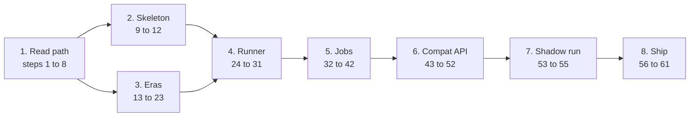

# Release 1 implementation plan

This plan turns the [design docs](../README.md) into 61 steps that build release 1 of the indexer. Each step is one commit. Each step ends with a command you run and the output you should see. You write the code that carries the learning, and a coding agent writes the mechanical parts and reviews your work.

Start with [step 1](01-read-path.md#step-1-build-create-the-workspace-and-print-a-blocks-runtime-specs). It fits one sitting, and it prints a real value from the chain.

## Open questions

Release 1 depends on these facts, and no measurement has answered them yet.

| Question | What is known so far | Answered by |
|---|---|---|
| How long the full backfill takes with all five jobs on one runner, under 16 permits and the cap of 120 calls a second | The cap of 120 calls a second and each job's rate measured alone bound the time between 1 h 30 min and 5 h 35 min. Both bounds assume the node's fast rate and leave out its slow windows. | Step 42 |
| Whether `chain.rpc_timeout = 90s` always covers `get_all_validator_baskets` | One call took 8.7 to 33.5 s depending on node load, and historic `state_call` latency ranges from 0.3 s to 19 s for one call. | Step 38 records the longest basket call and the `Timeout` count of its backfill, then step 42 |
| How the product's `SubxtSource` behaves under the runner for the jobs other than `prices`, and with the real store | The three real calls of `prices` under the runner stages of `spikes/crates/runner`, on the in-memory store, committed every block in order with no gap through a dropped socket, an 8 s outage, hung calls, and two jobs (`spikes/crates/runner-live`, `wiring`, `backfill-ws`, `drop`, `outage`, `hung-call`). | The hour-long live run that closes stage 4 |
| Whether the starvation test passes on real time with the real store | It passes on paused time against a fake store, and paused time cannot be used with real I/O. | Step 36 |
| Whether `chain specs --from 4920349` writes `fixtures/specs.csv` with the spec 219 base row and then the same rows as `spikes/data/specs.csv` | The bisection that produced `spikes/data/specs.csv` is research code, not the product's command. | Step 13 |
| The size of the trimmed validator fixture, how many keys per prefix it keeps, whether it replays offline, and the call counts of `chain validators` | A whole snapshot is 56 to 117 MB. | Step 21 |
| Whether SQLSTATE 57014 answers 503 | The research code answers it with 500, and the design's 503 mapping has not run yet. | Step 43, whose `/test/db` route cuts a query with `statement_timeout` |
| Whether `middleware::shed(cfg)` and `middleware::common()` each compile over its own layers | The signature compiles over the whole stack. | Step 43 |
| Whether a `utoipa` response with no `description` fails validation, and the flags of `oha` | Both come from reading the OpenAPI text and the `oha` documentation, with nothing run. | Step 51 runs `redocly lint` with one `description` removed. Step 52 runs `oha` |
| The p99 with real queries, against the target of 100 ms, and whether the `ANY($netuids)` query slows after five runs | The load test has served only canned data, and only the hotkey-only query has shown the generic-plan slowdown. | Step 52, and step 46, which runs the `ANY($netuids)` query seven times with `EXPLAIN (ANALYZE)` |
| Whether `/metrics` serves on its own port, and whether the log holds the full error chain for a 500 or a 503 | Metrics have rendered only in process, with no log subscriber installed. | Step 30 and step 31 serve `/metrics` on 9100 and 9101. Step 43 captures the log of a 500 and a 503 |
| Real table sizes and compression | The sizes come from generated rows, which compress better than chain data. | Step 42 |
| The headers tao-data-api sends under Cloudflare Workers | Only the Node runtime has been measured, and the code sets no header of its own. | Step 54 |
| Whether a compat route needs `ValidatorPermit` or `Keys`, which the squid's snapshot also reads | The five responses pass the consumer's schemas without them, and value equality with the squid has not been checked. | Step 54 |
| Rates above 40 calls a second, up to the default cap of 120 with 16 permits, and the WebSocket rates of the jobs other than `prices` | `prices` ran 10.99 blocks a second over one WebSocket under a cap of 40 for 2,000 blocks, two jobs on one WebSocket split the cap evenly, and every other per-job cost was measured over HTTP (`spikes/crates/runner-live`, `backfill-ws`, `two-jobs`). | Step 42 |
| Whether the router with both OpenAPI documents merged serves `/docs` and `/openapi.json` | The router has been built only with both documents discarded, and it served neither path. | Step 51 |
| Where JSON-RPC `-32004` comes from, and the public archive node's limit itself | No source for `-32004` is known, Substrate's state errors are 4001 to 4003, and no call has produced it, and it is in `RATE_LIMIT_CODES` (`spikes/crates/chain-errors`, `node-error-codes`). | No step answers it. Release 1 does not use that node |
| Whether a hung `storage().fetch` on the real node also takes two client timeouts | On a local server a hung `runtime_apis().call_raw` took two client timeouts (`archive_v1_call`, then `state_call`) and `storage().fetch` took one, on `archive_v1_storage`, while the outer `rpc_timeout` bounds both and release 1 reads storage through raw calls only (`spikes/crates/chain-errors`, `client-request-timeout`). | No step answers it on the real node. Step 29's hung-call test uses a fake source |
| How long a first start takes to fetch and store the metadata of the 11 specs that release 1's job windows touch, which later starts load from `runtime_version` | One `Metadata_metadata_at_version` fetch takes 0.9 to 8.8 s and 400 to 445 KB per spec, over specs 475, 482, and 490, and the store's part is not timed (`spikes/crates/chain-errors`, `metadata-fetch-time`). | Step 24 times the fetch and store of one spec. Step 42's backfill from an empty database times all 11 |
| Whether the 100-block jobs stay live at the live concurrency of 4 in flight, which needs each snapshot to commit within 5 minutes, because `IndexerLagging` fires after 5 minutes above 50 blocks | One `validators` snapshot took 131 s at 8 in flight and 451 s at 1. | The 24-hour shadow run, step 55 |
| Whether a real Postgres commit is dropped or retried under node faults | Every node fault has run against the in-memory store only. | Step 29's `crash_mid_batch` fails real commits on the real store. No step combines that with node faults |
| The cause of the node's slow windows | For windows of minutes `prices` fell to about 2 blocks a second with no error, while other clients whose load is not visible shared the key (`spikes/crates/runner-live`, `node-slow-windows`). | No step answers it. Step 42's log shows whether the windows recur |
| Whether the gateway cuts a WebSocket call at 120 s | The gateway cut one HTTP `get_delegates` call at 120 s with a 504, and the longest basket call measured is 33.5 s (`spikes/crates/chain-errors`, `node-error-codes`). | Step 38 records the longest basket call |
| Whether `classify` compiles with an optional spec, and what its `None` arm returns for a decode error | The two-layer call compiles and runs with `classify` taking a block and a spec (`spikes/crates/runner-live`, `wiring`) | Step 6 |
| Whether a node ever makes the client's own `RequestTimeout` fire | Our timeout sits 30 s below the client's, so it fires first in every run so far | Step 29 |
| Whether the `bt_=debug` log filter selects only this workspace's crates on a running subscriber | The crate names all start with `bt_` | Step 30 |
| Whether a test binary removes a leftover database container by its fixed name | A static container outlives its test binary | Step 9 |
| Whether `block_ref` costs one request once it reads both specs from the shared `VersionTable` | The job costs were measured with one request for the block and the spec taken from a constant. | Step 24 builds it. Step 42 checks the call count, about 3 a block for `prices` |

Three more open questions belong to release 2, and the [release 2 outline](release-2-outline.md) covers them: how to read prices for specs 290 to 390, whether a value changes its encoding in place across an upgrade, and what `stake_at_epoch` stores before spec 261. None of them affects release 1. No item it reads changes shape among the 11 mainnet specs it reads, 475 to 490 (`spikes/crates/chain-decode`, `shapes-r1-specs`), and in its window storage at an upgrade block decodes to the same values under the executing spec's metadata and the state spec's (`spikes/crates/chain-decode`, `storage-executing-spec`).

## The files

| File | What it holds |
|---|---|
| [Stage 1](01-read-path.md) to [stage 8](08-ship.md) | The steps, in order |
| [Learning map](learning-map.md) | Every Rust and tokio concept in the plan, the step that first uses it, and one primary source |
| Evidence ledger, `spikes/README.md` in `rust-bittensor-indexer-rnd` | Every claim the design and the plan rest on, with the command behind it and what it printed |
| `gen-tables.py` | Regenerates the step table below and the learning map from the stage files |
| [Release 2 outline](release-2-outline.md) | One page on what follows release 1 |

## The order, and why

The [roadmap](../design/10-roadmap.md) orders the milestones by risk, with the decoding proof, M0, first. This plan proves the read path against the real node first, builds the thinnest end-to-end path on it second, and then finishes M0.

| Stage | Steps | What you have at the end | Roadmap check it closes |
|---|---|---|---|
| [1. Prove the read path](01-read-path.md) | 1 to 8 | `bt-indexer chain ...` reads state at spec 233 and calls runtime APIs at old blocks | None yet. It retires the main design risk |
| [2. Walking skeleton](02-skeleton.md) | 9 to 12 | `prices` runs live, rows and checkpoint commit in one transaction, and `bt-indexer status` shows the block | None yet. First end-to-end demo |
| [3. Every era, offline](03-eras.md) | 13 to 23 | Fixtures and offline tests for every era of every value, and the parent-metadata proof | M0 |
| [4. The real runner](04-runner.md) | 24 to 31 | Concurrent reads, one writer, batch commits, shutdown, retries, metrics, `GET /status` | M1 |
| [5. The other four jobs](05-jobs.md) | 32 to 42 | `validators`, `epochs`, `baskets`, and `identities` with backfill windows | M2 |
| [6. The compat API](06-compat-api.md) | 43 to 52 | The five routes that tao-data-api calls, checked against its schemas | M3 |
| [7. Shadow the squid](07-shadow-run.md) | 53 to 55 | `compat diff` clean for 24 hours | M4 |
| [8. Ship release 1](08-ship.md) | 56 to 61 | The image, compose, CI, alerts, the runbook, and a tagged release | M5 |

Two facts measured against the node make the read path the first risk.

- Block 4,920,350, where dTAO starts, is itself an upgrade block. Spec 219 executed it, and its state reports spec 233. Its storage and events decode with spec 219's metadata, and a runtime API call at it runs spec 233's code. One subxt hook cannot serve both answers, so storage decodes raw bytes with a metadata the code picks ([D6](../decisions.md#d6-decode-storage-and-events-with-the-executing-spec-and-runtime-apis-with-the-blocks-own-spec)).
- `state_getMetadata` returns metadata that lists no runtime APIs. The plan fetches metadata with `Metadata_metadata_at_version` ([D7](../decisions.md#d7-fetch-metadata-with-metadata_metadata_at_version)).

Both facts change the shape of `Chain`. Stage 1 sets that shape in eight small steps, so the skeleton in stage 2 is built on a read path whose shape is already set. Stage 2's four steps are the only work that starts before M0 closes.



Inside a stage, each step builds on the ones before it. Across stages, each step uses only what earlier stages built, and the stage introductions name it. For example, step 11 uses the head price read of step 8, step 24 stores the spec boundaries that step 13 finds, and the runner tests of stage 4 serve recorded blocks from the `FixtureSource` of step 15. Step 2 (CI) can land any time after step 1. No step depends on a later one.

## How to work a step

1. Read the step. Read the design section it links, and the source under **Concepts** if the concept is new to you.
2. Create a branch named `step-NN`.
3. Write the parts marked as yours. The **Shape** gives the types and signatures, and you fill the bodies. If one body holds you for more than 20 minutes, show the agent what you have and ask for a review, not for the body.
4. Give the agent its parts. An agent-written step has a **Brief for the agent** that you can paste as the request.
5. Ask the agent to review your code against the step's **Review checks**. Fix what it finds.
6. Run the three standing checks, then the step's own **Check**.

   ```sh
   cargo fmt --all --check
   cargo clippy --workspace --all-targets -- -D warnings
   cargo test --workspace
   ```

7. Commit with the step's heading as the subject. Add a body when the change needs a reason. Merge with `git merge --ff-only`, and delete the branch.
8. At a **Stop here** block, run the demo and answer the questions aloud before the next stage.

Every file under a `tests/` directory opens with `#![allow(clippy::unwrap_used, clippy::expect_used)]`. The `clippy.toml` keys cover only code inside a `#[test]` function, so a helper in a test file fails the standing clippy without it.

Rules for the history:

- One step is one commit. A few steps name a natural second commit, and those are the only exceptions.
- Fixtures and generated files go in their own commit after the code commit, with a `test(fixtures)` or `docs` subject.
- `master` always passes the three standing checks.

## What you need

- **Rust 1.99.1**, pinned by `rust-toolchain.toml` in step 1.
- **The research repository**, `rust-bittensor-indexer-rnd`, checked out beside this one. The plan cites its probes as worked references, and step 13 compares its output with `spikes/data/specs.csv` there ([where the evidence lives](../README.md#evidence)).
- **An archive node**, with its URL in `BT_CHAIN__URLS`. Every block the plan reads is historic. The keyed archive endpoint behind the measurements allows 200 calls a second, and the design caps the client at 120 ([D23](../decisions.md#d23-cap-the-call-rate-with-a-one-token-bucket-not-only-the-calls-in-flight)). A public archive node runs at about 9 calls a second (measured on 2026-11-12). That is enough for stages 1 to 4, and too slow for the backfill in stage 5, which makes about 757,672 calls. Quote the URL when you export it. The keyed gateway without its `?apikey=` part accepts the connection and allows 10 calls a second (`spikes/crates/chain-errors`, `gateway-keyless`), so a URL that lost its key starts and then answers mostly `-32029`.
- **Docker**, from step 9, for PostgreSQL with TimescaleDB.
- **Node.js**, from step 44, for the schema test.

## Dependencies by step

Each step that first needs a crate says so with a line that links here. Add the crate to the workspace's `[workspace.dependencies]` with the version and features below, and name it with `.workspace = true` in each package that uses it. The versions resolve and build together as of 2026-11-13. A `=` pins the exact version. A row that says "choose at that step" has no pinned version yet. Pick the current release when you reach that step, and write it into this table.

| Crate | Version | Features | Package | First step |
|---|---|---|---|---|
| `subxt` | `=0.50.3` | default; `reconnecting-rpc-client` from step 29 | `bt-chain` | 1 |
| `tokio` | `1.54.1` | `macros`, `rt-multi-thread`, `signal`, `sync`, `time`; dev `test-util` for paused time, from step 27 | `bt-indexer` (1), `bt-chain` (6), `bt-ingest` (10), `bt-api` (31) | 1 |
| `thiserror` | `2.0.21` | none | every library crate | 1 |
| `anyhow` | `1.0.104` | none | `bt-indexer` | 1 |
| `clap` | `4.6.7` | `derive`, `env` | `bt-indexer` | 1 |
| `chrono` | `0.4.45` | `default-features = false`, `clock`, `std` | `bt-domain`, `bt-store`, `bt-indexer` | 5 |
| `sqlx` | `=0.8.6` | `default-features = false`, `runtime-tokio`, `postgres`, `macros`, `migrate`, `bigdecimal`, `chrono` | `bt-store`, then `bt-ingest` (11) and `bt-api` (31) | 9 |
| `testcontainers-modules` | `=0.15.0` | `postgres` | `bt-store` dev, then `bt-ingest` dev (25) | 9 |
| `bigdecimal` | `0.4.11` | none | `bt-store` | 11 |
| `serde` | `1.0.229` | `derive` | `bt-domain` (3), `bt-chain` (14), `bt-indexer`, `bt-api` | 3 |
| `serde_json` | `1.0.154` | none | `bt-chain`, `bt-indexer`, `bt-api` | 14 |
| `hex` | `0.4.3` | none | `bt-chain` and its tests | 14 |
| `insta` | `1.49.0` | none | `bt-chain` dev, then `bt-api` dev (31) | 15 |
| `scale-info` | `=2.11.6` | none | `bt-chain` dev, for the edited metadata of step 16 | 16 |
| `scale-decode` | `0.16.2` | `derive` | `bt-domain`, `bt-chain` | 17 |
| `futures` | `0.3.31` | none | `bt-ingest`, `bt-chain` | 26 |
| `tokio-util` | `=0.7.20` | `rt` | `bt-ingest`, then `bt-chain` (29) and `bt-api` (43) | 26 |
| `rand` | `0.9.5` | none | `bt-chain` | 29 |
| `tracing` | `0.1.44` | none | `bt-telemetry` and every crate with a span | 30 |
| `tracing-subscriber` | choose at that step (0.3.23 already resolves through another crate) | `json` for `telemetry.log_format` | `bt-telemetry` | 30 |
| `opentelemetry`, `opentelemetry-otlp`, `tracing-opentelemetry` | choose at that step | choose at that step | `bt-telemetry` | 30 |
| `metrics` | `=0.24.6` | none | `bt-telemetry`, `bt-chain`, `bt-ingest`, `bt-api` | 30 |
| `metrics-exporter-prometheus` | `=0.18.3` | `default-features = false`, plus its HTTP listener feature for its own port | `bt-telemetry` | 30 |
| `axum` | `=0.8.9` | `macros`, for `#[axum::debug_handler]` | `bt-api` | 31 |
| `tower` | `=0.5.3` | `limit`, `load-shed`, `timeout`, `util` | `bt-api` (`util` for `oneshot` in step 31's test) | 31 |
| `figment` | `0.10.19` | `toml`, `env`; dev `test` for `Jail` | `bt-indexer` | 32 |
| `secrecy` | `0.10.3` | `serde` | `bt-indexer` | 32 |
| `url` | `2.5.8` | `serde` | `bt-indexer` | 32 |
| `humantime-serde` | `1.1.1` | none | `bt-indexer` | 32 |
| `proptest` | choose at that step | none | `bt-domain` dev | 34 |
| `tower-http` | `=0.6.8` | `request-id`, `trace`, `cors`, `catch-panic`, `compression-gzip`, `set-header`, `util` | `bt-api` | 43 |
| `subxt-utils-accountid32` | `=0.50.3` | none | `bt-domain` | 46 |
| `utoipa` | `6.0.0` | none | `bt-api` | 51 |
| `utoipa-axum` | `0.3.0` | none | `bt-api` | 51 |
| `utoipa-swagger-ui` | `10.0.2` | `axum` | `bt-api` | 51 |
| `criterion` | choose at that step | none | dev, in the benchmark commit after step 52 | 52 |
| `reqwest` | choose at that step | `json`, `rustls-tls` | `bt-indexer` | 53 |

Three more facts about the table:

- `frame-decode` and the SCALE codec are never direct dependencies, and `scale-decode` is not one before step 17. Reach them as `subxt::ext::frame_decode`, `subxt::ext::codec`, and `subxt::ext::scale_decode`. A bare `frame_decode::...` path should not resolve without its own entry.
- A `DecodeAsType` derive needs the direct `scale-decode` entry. With `subxt` alone it fails with E0432, `unresolved import scale_decode`.
- Tools are not crates. Step 11 installs `cargo install sqlx-cli --version 0.8.6 --locked --no-default-features --features postgres,rustls`. Step 44 pins `zod` 3.25.76 in `tests/compat/package.json`, step 51 pins `@redocly/cli` there, and step 52 installs `oha` with `cargo install oha --locked`.

## The three riskiest steps

1. **Step 17, the parent-metadata proof.** Release 2 decodes events with the metadata of the parent block. The rule holds at block 5,228,683, where four `StakeAdded` events decode with spec 252's metadata and fail with spec 257's. The risk that is left is in your own `Config` impl, which needs seven associated types and cannot delegate `TransactionExtensions`.
2. **Steps 26 to 28, the read stage, the writer, and shutdown.** The bugs here look like success. A read that nobody polls holds a permit. A closed channel reads as the end of a range. A task waiting in `recv()` ignores cancel. The tests in these steps each fail on one of those bugs.
3. **Step 35, the validator snapshot.** It is the most expensive read. One snapshot measured 286 calls, 57 MB, and 131 s at 8 calls in flight, and it feeds three of the five routes. Step 21 records a trimmed fixture for it early.

## Every step

This table and the [learning map](learning-map.md) are generated from the stage files. Run `python3 docs/plan/gen-tables.py` after you edit a step, and `python3 docs/plan/gen-tables.py --check` to see whether they are current.

<!-- steps:start -->
| Step | Stage | Commit subject | Who writes it | Concepts first used | Check |
|---|---|---|---|---|---|
| 1 | [1](01-read-path.md) | `build: create the workspace and print a block's runtime specs` | human | Cargo workspace, `#[tokio::main]`, thiserror in libraries, anyhow in the binary | `cargo run -p bt-indexer -- chain spec --block 4920350` |
| 2 | [1](01-read-path.md) | `ci: check format, lints, and tests on every push` | agent | none | `git push origin master && gh run watch` |
| 3 | [1](01-read-path.md) | `feat(domain): parse block numbers and specs into newtypes at the CLI` | human | Newtype, Parse at the boundary | `cargo run -p bt-indexer -- chain spec --block 5000000000` |
| 4 | [1](01-read-path.md) | `feat(chain): fetch a block's metadata and report what it declares` | human | `Arc<RwLock<_>>` | `cargo run -p bt-indexer -- chain metadata --block 4920350` |
| 5 | [1](01-read-path.md) | `feat(chain): read one storage value through a BlockSource` | human | RPITIT with `+ Send`, Static dispatch | `cargo run -p bt-indexer -- chain read --block 4920350` |
| 6 | [1](01-read-path.md) | `feat(chain): classify node errors and time-bound every call` | human | Exhaustive `match`, Boxing a large error, `tokio::time::timeout` | `cargo test -p bt-chain classify` |
| 7 | [1](01-read-path.md) | `feat(chain): read prices from storage for the pre-290 era` | human | Enums chosen from data | `cargo run -p bt-indexer -- chain prices --block 4920351` |
| 8 | [1](01-read-path.md) | `feat(chain): read prices from the runtime API from spec 290` | human | Collecting into `Result` | `cargo run -p bt-indexer -- chain prices --block <n>` |
| 9 | [2](02-skeleton.md) | `feat(store): apply the pipeline migrations with bt-indexer migrate` | both | A hand-written `From` and `?`, `sqlx::migrate!` | `docker compose -f deploy/compose.yaml up -d --wait db && cargo run -p bt-indexer -- migrate` |
| 10 | [2](02-skeleton.md) | `feat(ingest): follow the finalized head and show it in status` | both | `tokio::sync::watch`, `tokio::select!` with `ctrl_c` | `cargo run -p bt-indexer -- ingest` |
| 11 | [2](02-skeleton.md) | `feat(ingest): index prices live with rows and checkpoint in one transaction` | both | A trait with an associated const and type, sqlx `Transaction`, `query!` offline data | `cargo run -p bt-indexer -- status` |
| 12 | [2](02-skeleton.md) | `feat(domain): compute lag, percent done, and ETA in one function` | both | `impl Display` | `cargo test -p bt-domain progress` |
| 13 | [3](03-eras.md) | `feat(cli): list every runtime upgrade by bisection` | agent | none | `cargo run -p bt-indexer -- chain specs --from 4920349 > fixtures/specs.csv` |
| 14 | [3](03-eras.md) | `feat(cli): record a block's state as a fixture` | agent | serde derive | `cargo run -p bt-indexer -- fixture record --block 4920351 --case spec_233_block_state --read block_state` |
| 15 | [3](03-eras.md) | `test(chain): decode the spec 233 fixture offline` | human | Integration tests in `tests/`, insta snapshots | `cargo test -p bt-chain --test decode spec_233_block_state` |
| 16 | [3](03-eras.md) | `test(chain): decode prices offline in every era` | both | none | `cargo test -p bt-chain --test decode prices_` |
| 17 | [3](03-eras.md) | `feat(chain): prove the parent-metadata rule at a StakeAdded upgrade` | both | A foreign trait with associated types, `[u8; 32]` account newtypes, `BTreeMap::range` | `cargo test -p bt-chain parent_metadata && cargo test -p bt-chain own_metadata` |
| 18 | [3](03-eras.md) | `feat(chain): read epoch dividends before and after spec 261` | both | none | `cargo test -p bt-chain epochs` |
| 19 | [3](03-eras.md) | `feat(chain): read baskets in both summary shapes` | both | Fixed-point from raw bits | `cargo test -p bt-chain baskets` |
| 20 | [3](03-eras.md) | `feat(chain): read subnet identities and decode text like the squid` | both | `String::from_utf8_lossy` and `Cow`, `char` predicates | `cargo test -p bt-domain text && cargo test -p bt-chain identities` |
| 21 | [3](03-eras.md) | `feat(chain): read validator snapshot inputs with paged storage` | both | Sequential async paging | `cargo test -p bt-chain validators` |
| 22 | [3](03-eras.md) | `docs: list every shape change since spec 233` | agent | none | `cargo run -p bt-indexer -- metadata diff > docs/shape-changes.md` |
| 23 | [3](03-eras.md) | `docs(decisions): record how historic decoding works` | both | none | `unshare -rn cargo test -p bt-chain --offline` |
| 24 | [4](04-runner.md) | `feat(ingest): persist runtime versions and refill the cache on start` | both | `#[must_use]` effect values | `cargo test -p bt-chain sparse_reader` |
| 25 | [4](04-runner.md) | `test(ingest): index the same blocks twice and get identical tables` | both | A database per test from a template | `cargo test -p bt-ingest same_blocks_twice` |
| 26 | [4](04-runner.md) | `feat(ingest): read blocks concurrently in order and hand rows to one writer` | both | `buffered` over spawned tasks, `'static` tasks with `Arc` and `async move`, Abort on drop, Bounded `mpsc` | `cargo test -p bt-ingest read_` |
| 27 | [4](04-runner.md) | `feat(ingest): commit batches by block count or wait time` | human | `select!` cancel safety, Paused time | `cargo test -p bt-ingest batch_` |
| 28 | [4](04-runner.md) | `feat(ingest): stop every task on one token and exit with the right code` | human | `CancellationToken`, `JoinSet` and the two error layers, `ExitCode` | `cargo test -p bt-ingest shutdown_` |
| 29 | [4](04-runner.md) | `feat(chain): cap the RPC rate, share permits, and retry with backoff` | both | Permits do not bound the rate, Closures that return futures | `cargo test -p bt-chain retry_` |
| 30 | [4](04-runner.md) | `feat(telemetry): log every commit and export progress metrics` | agent | `#[instrument]` on async functions | `curl -s localhost:9100/metrics | grep 'bt_lag_blocks{worker="prices"}'` |
| 31 | [4](04-runner.md) | `feat(api): serve GET /status from the checkpoint tables` | both | axum extractors and `State` | `curl -s localhost:8080/status | jq -c '.workers[0] | {worker, mode}'` |
| 32 | [5](05-jobs.md) | `feat(config): load configuration from defaults, files, and environment` | agent | Layered config into one typed struct, `SecretString` | `env -u BT_CHAIN__URLS cargo run -q -p bt-indexer -- ingest; echo $?` |
| 33 | [5](05-jobs.md) | `feat(ingest): start jobs at their history window and switch between backfill and live` | human | Policy as enums and pure functions | `cargo run -q -p bt-indexer -- status --watch` |
| 34 | [5](05-jobs.md) | `feat(domain): compute global weighted stake with checked u128 math` | human | Checked arithmetic under a deny lint, Property tests | `cargo test -p bt-domain weighted_stake` |
| 35 | [5](05-jobs.md) | `feat(ingest): index the validator snapshot` | both | none | `cargo run -q -p bt-indexer -- status` |
| 36 | [5](05-jobs.md) | `test(ingest): prove a stalled writer does not starve another job` | both | `Notify` as a test gate | `cargo test -p bt-ingest stalled_writer` |
| 37 | [5](05-jobs.md) | `feat(ingest): index epoch dividends over a 31-day window` | both | none | `cargo run -q -p bt-indexer -- status --watch` |
| 38 | [5](05-jobs.md) | `feat(ingest): index basket snapshots from spec 441` | both | none | `cargo run -q -p bt-indexer -- status` |
| 39 | [5](05-jobs.md) | `feat(ingest): index subnet identities as a latest-only set` | both | none | `cargo run -q -p bt-indexer -- status` |
| 40 | [5](05-jobs.md) | `feat(ingest): verify retention policies and add an hourly gap check` | agent | none | `cargo test -p bt-store retention` |
| 41 | [5](05-jobs.md) | `feat(deploy): add the Grafana progress dashboard` | agent | none | `docker compose -f deploy/compose.yaml up -d prometheus grafana` |
| 42 | [5](05-jobs.md) | `docs(readme): record measured backfill time per job` | human | none | `cargo run -q -p bt-indexer -- status --watch` |
| 43 | [6](06-compat-api.md) | `feat(api): answer every failure as problem+json behind the middleware stack` | both | `IntoResponse` for an error enum, Layer order in `ServiceBuilder`, `Error::is` on a boxed error | `cargo test -p bt-api --test errors` |
| 44 | [6](06-compat-api.md) | `feat(api): serve GET /v1/subnet-identities and check it with tao-data-api's schema` | both | serde container attributes, Router tests with `oneshot` | `cargo test -p bt-api --test compat identities` |
| 45 | [6](06-compat-api.md) | `feat(domain): compute epoch APY and root APR` | human | `Option<f64>` as null | `cargo test -p bt-domain apy` |
| 46 | [6](06-compat-api.md) | `feat(api): serve both stake routes with APYs` | both | Wrapping an extractor, Custom `Serialize` | `cargo test -p bt-api --test compat stake` |
| 47 | [6](06-compat-api.md) | `feat(domain): format pool numbers the way the squid does` | human | Exact decimals from integers, Arithmetic the lint accepts | `cargo test -p bt-domain format` |
| 48 | [6](06-compat-api.md) | `feat(api): serve GET /pools` | both | none | `cargo test -p bt-api --test compat pools` |
| 49 | [6](06-compat-api.md) | `feat(api): serve GET /validators` | both | `Ordering::then_with` for a tie-break | `cargo test -p bt-api --test compat validators` |
| 50 | [6](06-compat-api.md) | `feat(api): report readiness per job window on /readyz` | human | A background task on `tokio::time::interval` | `curl -si localhost:8080/readyz | head -1` |
| 51 | [6](06-compat-api.md) | `feat(api): generate the OpenAPI document from the handlers` | agent | none | `cargo test -p bt-api openapi_is_current` |
| 52 | [6](06-compat-api.md) | `perf(api): load test the compat routes and shed overload` | both | none | `scripts/load.sh` |
| 53 | [7](07-shadow-run.md) | `feat(cli): diff /pools against the squid at an aligned block` | both | `tokio::join!`, `serde_json::Value` as the compared type | `cargo test -p bt-indexer compare_rows` |
| 54 | [7](07-shadow-run.md) | `feat(cli): diff the validator and identity routes against the squid` | both | none | `cargo run -p bt-indexer -- compat diff --squid $SQUID_URL` |
| 55 | [7](07-shadow-run.md) | `docs: record the 24-hour shadow run` | both | none | `jq -s 'length, (map(.differences) | add)' runs.jsonl` |
| 56 | [8](08-ship.md) | `build(docker): build a small image with cargo-chef` | agent | none | `docker build -t bt-indexer . && docker run --rm bt-indexer --help` |
| 57 | [8](08-ship.md) | `feat(deploy): run the full stack with docker compose` | agent | none | `docker compose -f deploy/compose.yaml up -d && docker compose -f deploy/compose.yaml exec ingest bt-indexer status` |
| 58 | [8](08-ship.md) | `ci: add sqlx, deny, machete, docs, coverage, OpenAPI, and image jobs` | agent | none | `git push origin master && gh run watch` |
| 59 | [8](08-ship.md) | `feat(deploy): add alert rules and a runbook section per alert` | both | none | `docker run --rm -v "$PWD/deploy/prometheus:/p" --entrypoint promtool prom/prometheus check rules /p/alerts.yaml` |
| 60 | [8](08-ship.md) | `docs(readme): open with docker compose up and the measured numbers` | human | none | `docker compose up` |
| 61 | [8](08-ship.md) | `chore(release): tag v0.1.0 with a generated changelog` | agent | none | `git cliff --latest` |
<!-- steps:end -->